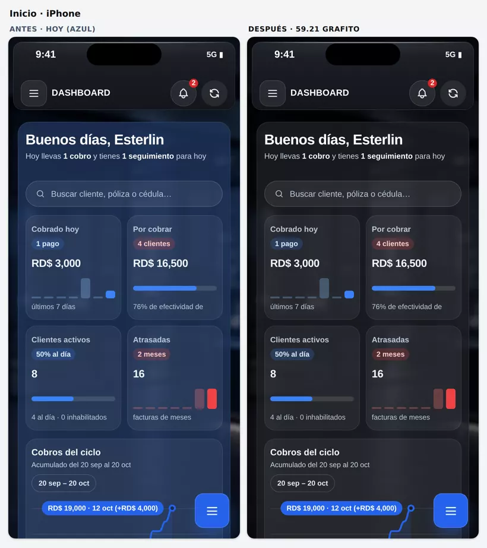
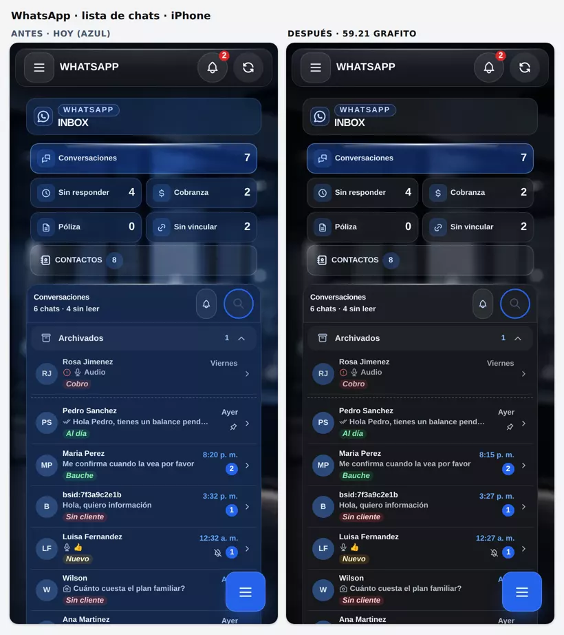
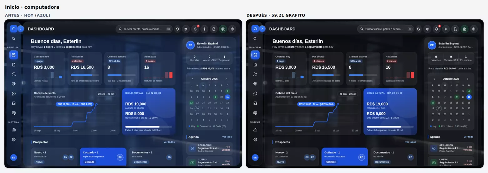

# 2026-10-11 20:45 — Claude · 59.21: modo oscuro grafito (más oscuro, translúcido y sin azul) — sin publicar

## Pedido del dueño
> «Sobre la apariencia de Nexus Pro… tiene dos apariencias, una blanco y otra oscura. En modo oscuro, podemos ponerlo un poquito más oscuro, un poco transparente, un poquito borroso, porque actualmente se ve como oscuro azul.»

## Fuente de verdad (auditada antes de tocar)
- **Dónde vive el tema oscuro:** `html.tema-glass-oscuro`, en `index.html` (`style#nxTemaGlassOscuro` y los bloques que siguen). Sus tokens `--tgo-*` cubren la escena, el cristal, las tarjetas, las hojas y los campos.
- **Cómo se pinta la escena:**
  - `html::before` lleva un degradado.
  - `html.tgo-foto::after` lleva la foto ya desenfocada, con velo y viñeta.
  - La foto se pide en el arranque con `window.nxTgoFoto()`.
  - El color del primer cuadro sale de `window.nxTgoBg()`, que es igual a `--tgo-bg`.
- **Sin parpadeo (FOUC):** los colores se cambiaron en su sitio, en los mismos tokens que ya vienen con la página. No se añadió ninguna capa tardía, que fue lo que causó el rollback del PR #311.
- **Azul marino fuera de los tokens:**
  - en `index.html`: el Buzón y el menú de cristal (`--nx-mc-glass`);
  - en las capas `parches-whatsapp-*.js`: ventanas, menús y paneles;
  - en `parches-nav-botones.js`.
  - Las capas `.css` no tienen azul en reglas del tema oscuro (revisado regla por regla).
- **La barra superior ya era grafito sólido desde el 02-oct.** La pinta `parches-sidebar-curva.css` («Glassy Navbar UI»), por decisión del dueño: «sin neblina encima del contenido». **Se respeta: no se volvió transparente.**

## Qué se hizo (rama `claude/tema-oscuro-cristal`, desde `main` 89ca1a2)

### 1. Tokens del tema (`index.html`)

| Qué | Antes (59.20) | Ahora (59.21) |
|---|---|---|
| Cristal `--tgo-glass` | `rgba(30,50,86,.56)` | `rgba(28,30,35,.50)` (más transparente) |
| Sólidos | `#182C4C` / `#10203A` | `#1D1F24` / `#121418` |
| Fondo de arranque `--tgo-bg` | `#10203A` | `#0E1013` |
| Base de la escena | `#16294D` / `#10203A` / `#0B1730` | `#16181C` / `#0E1013` / `#08090B` |
| Brillo | azul `rgba(37,99,235,.18)` | gris `rgba(140,155,180,.06)` |
| Velo | `.32→.48` | `.46→.62` (más oscuro) |
| Viñeta | `.42` | `.52` |
| Hojas y modales `--tgo-sheet` | `#1E365A→#152A4A` | `#24272D→#1B1D22` |
| Campos | `#142440`, borde `#7A8CA8` | `#17191D`, borde `#737B88` (4.1:1 sobre el campo) |
| Paleta del Buzón `--wa-*` | `#10203A` / `#14284A` / `#1C365E` / `#24406C` | `#121418` / `#16181C` / `#1E2126` / `#262A31` |
| Texto secundario del Buzón | `#B8C7DE` | `#B4BCC8` |

En el comentario de la escena quedó la línea **B** con los valores azul noche, para poder volver atrás.

### 2. Fotos de fondo
- Nuevas: `assets/fondo-login-grafito.webp` (21 KB) y `assets/fondo-login-movil-grafito.webp` (7,6 KB).
- Son las mismas fotos, sin color azul y más oscuras.
- `nxTgoFoto` y `html.tgo-foto::after` piden estas mismas fotos.

### 3. Translúcido y borroso
- **Tarjetas del celular** (`--tgo-card`): `rgba(30,50,86,.76)` → `rgba(30,32,38,.62)`. Dejan ver la foto desenfocada que hay detrás.
- **Panel principal de la computadora** (`.main::before`): `rgba(30,50,86,.66)` → `rgba(22,24,28,.56)`.
- **Menú de cristal de la computadora** (`--nx-mc-glass`): `rgba(42,64,102,.60)→rgba(20,36,64,.62)` → `rgba(46,49,56,.58)→rgba(22,24,28,.62)`. Mantiene su `blur(28px)`.
- **Cabecera del celular en `index.html`:**
  - antes era azul `rgba(30,50,86,.92)` hasta que llegaba la capa de la barra;
  - ahora es el mismo grafito sólido que pinta `parches-sidebar-curva.css`;
  - así el primer cuadro y el final son iguales, sin desenfoque.

### 4. Azules que quedaban
El cambio se aplicó solo a reglas `html.tema-glass-oscuro`:
- **Colores:**
  - `rgba(20,41,75,a)` → `rgba(30,32,38,a)`;
  - `rgba(13,28,53,a)` → `rgba(22,24,28,a)`;
  - `#0D1C35` → `#16181C`;
  - `#0A1628` → `#101215`;
  - `#1B3358` → `#262A31`;
  - `#14294B` → `#1F2126`;
  - `#24406C` → `#262A31`.
- **Líneas** azul claro `rgba(147,179,221,a)` → gris `rgba(190,200,215,≈a×0,75)`.
- **Archivos:**
  - `index.html`: cabecera, KPI y herramientas del Buzón; hoja de contactos; login `.lbox`; notificaciones, dock, opciones de select, toast, etc.;
  - `parches-whatsapp-chat-acciones.js`, `-media-historial.js`, `-plantillas-facil.js`, `-voz-mensajes.js`, `-admin-delete.js`;
  - `parches-nav-botones.js` (reducir transparencia).
- **Fondos de chat elegibles:** «soft» y «clean» pasan a grafito. «blue» y «mint» se quedan, porque son colores que el usuario elige.
- **Menú de la lista de chats y panel de emojis** (`parches-whatsapp-lista-original.js`):
  - ahora usan las variables `--nxwa-pop`, `--nxwa-pop-2` y `--nxwa-pop-edge`, con el azul de antes como respaldo;
  - el tema oscuro las pone en grafito;
  - el tema claro sigue igual.
- **Configuración → Apariencia:** la vista previa de «GLASS OSCURO» ahora sale en grafito.

### 5. Se quedan en azul a propósito
Es el acento NEXUS `#2563EB` (decisión del 30-sep):
- botones principales;
- ítem activo del menú;
- burbujas que uno envía en WhatsApp;
- tarjeta «Ciclo actual»;
- círculos de iniciales;
- chips de estado.

### 6. Versión
- `APP_VERSION` 59.20 → 59.21.
- Loader `b=6025` → `b=6026`.
- `version.json` con las notas.

### 7. Pruebas actualizadas
Esperaban los valores azules:
- **`scripts/qa-tema-glass.mjs`:**
  - fondo de arranque, splash, tarjeta de login, panel principal y cajón en grafito;
  - nombres de las fotos `*-grafito.webp`.
- **`scripts/qa-whatsapp-lista.mjs`:**
  - el cristal del buscador se compara contra el token `--nxbp-fondo` resuelto;
  - el menú y los emojis se comprueban como «oscuro» sin atar el tono (`esOscuro`).
  - Arregla las 2 fallas que ya existían en `main`.
- **`scripts/qa-isla-avisos.mjs`:** el número de build se lee de `parches-seguros.js`, para no romperse en cada versión.

## No se tocó
- Supabase (tablas, RPC, triggers, migraciones), Edge Functions, Zernio, Realtime, cobros, automatizaciones y la lógica del Buzón.
- **El tema claro.** Se comparó con las mismas capturas en las dos versiones: es idéntico, salvo la vista previa del tema oscuro en Configuración.

## Pruebas
Todas corrieron con la REST simulada `qa-crm-mock-server.js`.

| Prueba | Resultado |
|---|---|
| `qa-tema-glass` | **550/550** |
| `qa-iphone` | **571/571** |
| `qa-whatsapp-lista` | **151/151** |
| `qa-legibilidad` | **154/154** |
| `qa-vidrio-smart` | **18/18** |
| `qa-isla-avisos` | **38/38** |
| `qa-whatsapp-legibilidad` | **116/118** (las 2 fallas no son de esta entrega) |

- **`qa-tema-glass`:**
  - el contraste de cada pantalla es **igual que en producción**: 0 cambios en textos bajo 4,5:1, bajo 3:1 o ilegibles, en los 5 recorridos (390/1280, admin/agente y clásico);
  - las superficies quedaron más oscuras: la luminancia máxima baja en todas, por ejemplo Inicio 390 de 0,051 a 0,028.
- **`qa-whatsapp-legibilidad`:** producción (59.20) da el mismo 116/118. Las 2 fallas son textos sobre miniaturas de fotos en el chat y la burbuja de «ventana cerrada», y la pantalla medida varía según el desplazamiento.
- **Búsqueda de azul marino visible:** un script de capturas recorrió 24 pantallas y menús, en iPhone 390 con área segura 59 y en computadora 1280.
  - 9 pantallas comparadas en las dos versiones: **111 superficies en producción → 13 en la rama**.
  - Lo que queda en esas 13 son acentos: verde `#047857`, turquesa `#0F766E`, la tarjeta azul «Ciclo actual» y la vista previa de otros temas en Configuración.
  - En otras 15 pantallas revisadas (Pólizas, Solicitudes, CRM, POS, Préstamos, notificaciones, búsqueda…), solo los mismos acentos.
- **Errores de página:** 0.

## Antes / después

## Riesgos y pendientes
- **Falta verlo en el iPhone real**, con fotos y desplazamiento.
- **Hallazgo aparte, no se tocó:** en la app abierta desde el ícono (pantalla completa), las ventanas como «Registrar pago» no reservan el espacio de arriba (`env(safe-area-inset-top)`). El título y la X podrían quedar debajo de la hora. Pasa igual en 59.20. Revisarlo en una entrega aparte si el dueño lo ve.
- **Para volver atrás:** `git revert` del commit. A mano: los valores de la línea B del comentario de la escena y las fotos `fondo-login*.webp`, que siguen en `assets/`.

## Publicación
- **No publicado.** Espera el «publícalo» del dueño.
- **Al publicar:**
  - fast-forward de `main` desde la rama;
  - `AGENTS.md` (estado vivo → 59.21);
  - bitácora de publicación.
- Se usó una rama de entrega propia, como con la 59.20. La rama designada `claude/review-claude-md-jpzk7k` sigue llevando el commit `56ebb2f` sin publicar, y así no se mezclan entregas.

## Skills usadas
- **`apple-design`:**
  - materiales translúcidos sobre un fondo ya desenfocado;
  - superficies grandes más «gruesas» que las pequeñas;
  - un solo color de acento en lo que se toca;
  - respeta «reducir transparencia».
- **`webapp-testing`:** Playwright, para las pruebas y las capturas.
