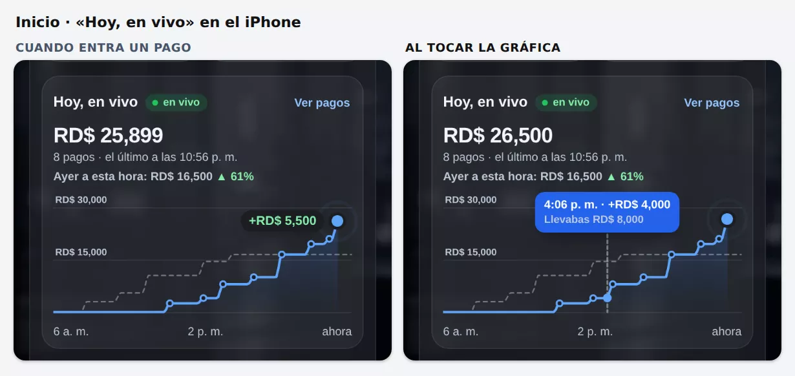
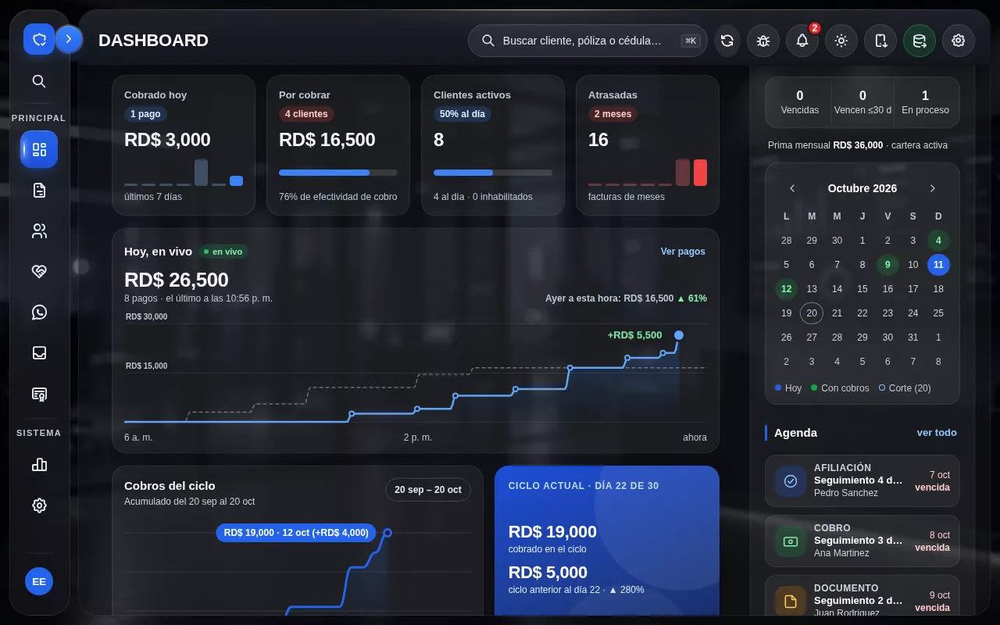

# 2026-10-11 22:57 — Claude · 59.21: «Hoy, en vivo», la gráfica de lo cobrado hoy que sube sola — sin publicar

## Pedido del dueño
> «Haz la gráfica en vivo de lo cobrado.»

La idea sale del reel de @adrien.ninet revisado en `2026-10-11-2238-claude.md` (Liveline, de Benji Taylor, licencia MIT). Va en la misma rama `claude/tema-oscuro-cristal` y en la misma versión 59.21, que todavía no se ha publicado.

## Fuente de verdad (auditada antes de tocar)
- **«Cobrado hoy» del Inicio:**
  - sale de `nxIGCiclo(c)` con `c.abonos`;
  - `c.abonos` es la lista que baja `rChartCobros()` con `API.get('abonos','select=fecha,monto')`;
  - se agrupa por día con `fechaRD()` (hora de RD, UTC−4) y se suma `Number(a.monto)`.
- **Es la misma cifra** del ciclo, del calendario y de la tarjeta azul «Ciclo actual».
- **Hora de cada pago**, revisada en producción (`tnwsgcxurfyuszxsewsn`) con consultas de solo lectura:
  - `abonos.fecha` es `timestamptz`;
  - de 434 abonos, los **168 de los últimos 60 días** traen la hora real del registro (`fecha` ≈ `created_at`);
  - los 232 que solo traen fecha a las 00:00 UTC son importaciones anteriores a agosto;
  - no hay abonos reversados en esos 60 días.
- **Cuándo se refresca hoy:**
  - en el equipo que registra el pago: `regAbono()` → `rDash()` → `rChartCobros()` → `nxIGCiclo()`;
  - para los pagos de otros agentes no había nada en vivo: no existe un canal Realtime de `abonos`.

## Qué se hizo (`index.html`, sin capas nuevas)
- **Tarjeta `#nxCV` «Hoy, en vivo»** debajo de los 4 KPI y encima de «Cobros del ciclo».
  - El esqueleto tiene las medidas finales desde el primer cuadro, así que nada salta.
  - En el celular, la comparación con ayer tiene su propia línea reservada.
- **`<style id="nxCobVivoCSS">`:**
  - colores en variables para el tema claro y el oscuro grafito;
  - latido con `transform`/`opacity` (liviano);
  - con «reducir movimiento», nada se anima.
- **Script «HOY, EN VIVO»**, junto al resto del Inicio glass:
  - **Mismos números:** `nxIGCiclo()` le pasa a `nxCVDatos()` la misma lista de abonos (una línea con `try`), y esa función filtra con la misma regla (`fechaRD===hoyRD`). No hay otra cuenta de dinero.
  - **Gráfica en `<canvas>`:**
    - el acumulado de hoy hora por hora, desde las 6 a. m. (o desde el primer pago, si fue antes) hasta «ahora»;
    - cada pago sube en ~6 px y termina justo a su hora;
    - un punto por cada pago;
    - lo de ayer en rayas;
    - rejilla con montos;
    - escala con margen: solo crece cuando la línea pasa del 92 % del tope, así que casi siempre la punta sube a la vista.
  - **Cuando entra un pago:**
    - la línea sube en 0,95 s;
    - el total cuenta hacia arriba;
    - sale «+RD$ …» junto a la punta, que late en «ahora».
  - **Cabecera:**
    - «N pagos · el último a las h:mm»;
    - «Ayer a esta hora: RD$ … ▲/▼ %».
  - **Al tocar o pasar el mouse:**
    - sobre un pago, sale la hora, «+RD$», el cliente y «Llevabas RD$ …»;
    - en otro punto, sale la hora, lo cobrado hasta esa hora y lo de ayer a esa hora.
  - **Pagos de OTROS agentes:**
    - mientras el Inicio está a la vista y la app abierta, cada 30 s se leen solo los abonos de hoy (`select=fecha,monto,cliente_id&fecha=gte.<hoy>T04:00:00Z`; solo lectura, con los permisos del usuario);
    - si cambió la cantidad o el total, se llama a la misma `rChartCobros()`, que repinta «Cobrado hoy», el ciclo, el calendario y esta gráfica con los mismos datos.
    - **Realtime no se toca.**
  - **«en vivo» / «sin conexión»:**
    - la etiqueta dice «en vivo» solo si esa lectura salió bien;
    - si falla, dice «sin conexión» (gris) y espera más entre intentos, hasta 5 min.
  - **A medianoche** se rehace todo para el día nuevo.
  - **Interruptor:** `window.NX_COBRO_VIVO=false` oculta la tarjeta.
- **`version.json`:** nota nueva en 59.21.

## No se tocó
- Supabase (tablas, RPC, triggers, permisos), Edge Functions, Realtime, `regAbono()` ni la lógica de cobro.
- Lo que muestran «Cobrado hoy», el ciclo y el calendario. Las 3 cifras salen de la misma lista y siguen iguales.

## Pruebas
- **`scripts/qa-cobro-vivo.mjs` (nueva): 73/73.** Corre a 390 y 1280 px, en grafito y en tema claro, y con «reducir movimiento». Comprueba:
  - el lugar de la tarjeta;
  - que el total es igual a «Cobrado hoy» y cuadra con un cálculo aparte sobre los abonos del simulador;
  - que la gráfica está dibujada y tiene su resumen para lectores de pantalla;
  - que el alto no cambia al llegar los datos;
  - que nada se sale de la pantalla;
  - en un día de ejemplo: total, cantidad, último pago y comparación con ayer;
  - que un pago de este equipo sube con «+RD$ 5,500» y el conteo;
  - la etiqueta al tocar o con el mouse;
  - un **pago de otro agente insertado en el simulador**: con la consulta, «Cobrado hoy» y la gráfica pasan juntas al total nuevo;
  - «sin conexión» y la vuelta a «en vivo»;
  - con «reducir movimiento», el cambio de una vez, sin latido ni «+RD$»;
  - 0 errores de página.
- Las demás pruebas del Inicio se corrieron de nuevo con la tarjeta puesta; el resultado está en la bitácora de cierre de la 59.21.

## Antes / después

## Riesgos y pendientes
- **Verlo en el iPhone real** con pagos de verdad: el latido, el toque y que no gaste batería de más (la lectura solo corre con el Inicio a la vista).
- **Los agentes ven la misma cifra que ya ven en «Cobrado hoy».** La gráfica no cambia quién ve qué.
- **El reverso de un pago:** si un pago se reversa y deja de contar en «Cobrado hoy», la línea baja igual que la cifra. En la base no hay reversos en 60 días; no se probó con uno real.

## Publicación
- **No publicado.** Va con la 59.21 completa cuando el dueño diga «publícalo».

## Skills usadas
- **`apple-design`:**
  - la respuesta sigue al dedo;
  - el total cuenta hacia arriba con la misma curva que la línea;
  - respeta «reducir movimiento»;
  - nada salta al cargar.
- **`webapp-testing`:** Playwright.
