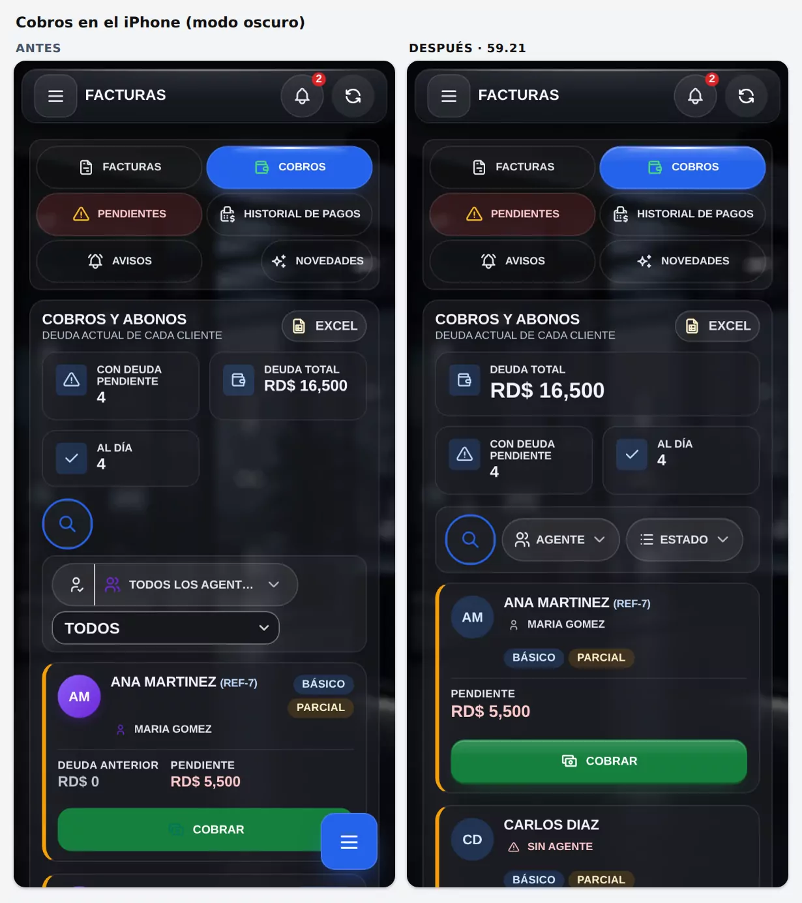
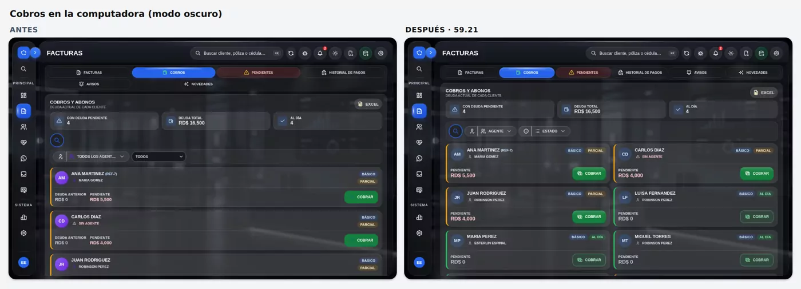
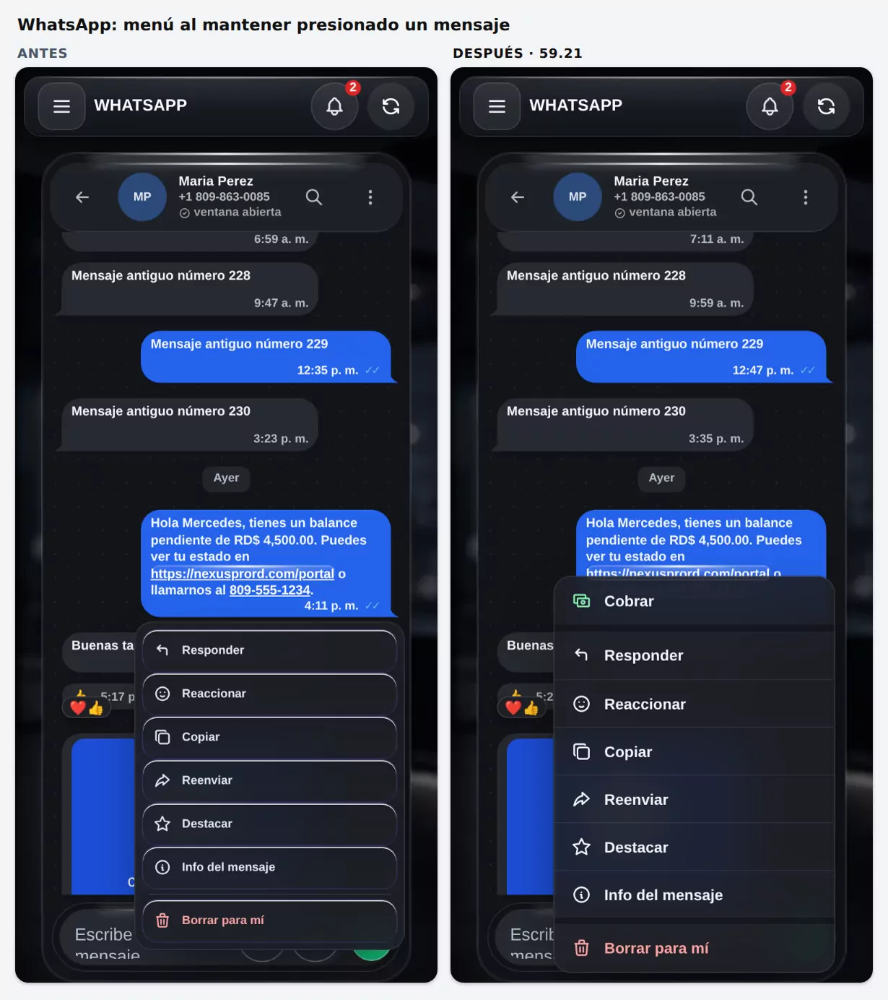
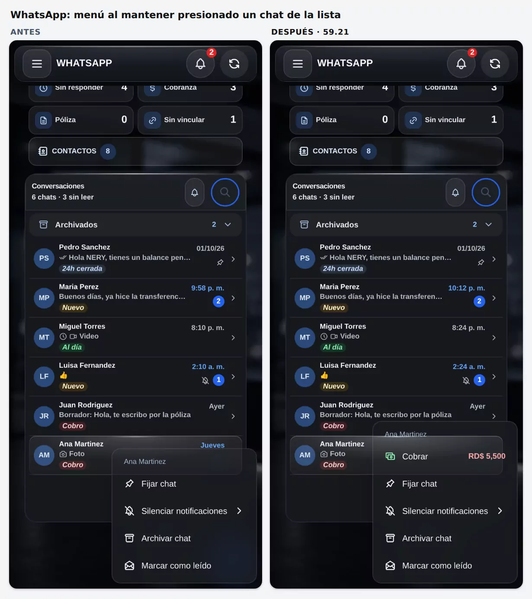
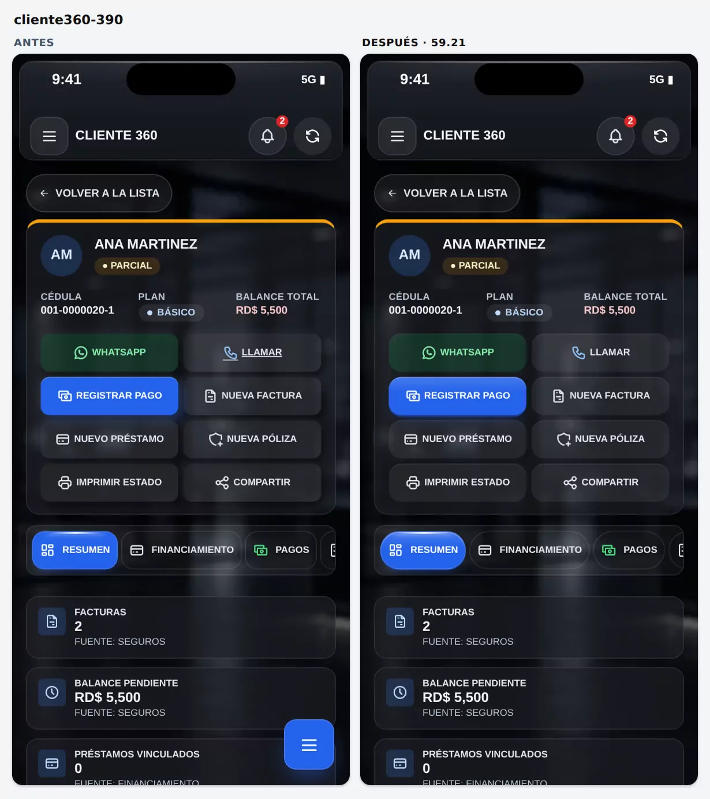
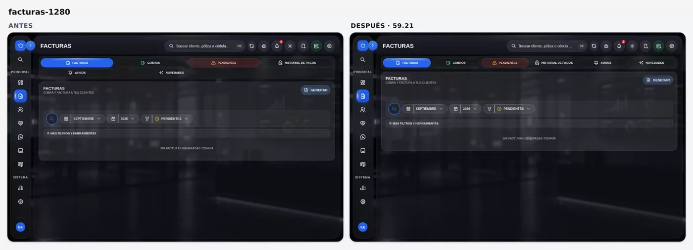

# 2026-10-11 23:28 — Claude · 59.21 (2.ª parte, cierre): botones «nivel pro», fuera el botón flotante ☰, «Cobrar» en WhatsApp, pantalla de Cobros y «Hoy, en vivo» — publicada a continuación

Sigue a `2026-10-11-2045-claude.md` (modo oscuro grafito). Es la misma rama, `claude/tema-oscuro-cristal`, y la misma versión, 59.21, que todavía no se ha publicado.

**Commits:**
- `894ecec` botones y botón flotante;
- `872dc8f` «Cobrar» en los menús de WhatsApp;
- `36f4f08` menú del mensaje;
- `392001d` pantalla de Cobros;
- `0037665` menús de WhatsApp junto al borde de abajo;
- `dc1213b` «Hoy, en vivo» (con su propia bitácora, `2026-10-11-2257-claude.md`);
- `7cd7650` «Hoy, en vivo» con la regla del Inicio (12 px y toque de 44 px);
- este commit: esta bitácora.

## Pedidos del dueño (11-oct-2026)
1. «Vamos a aprovechar y con los links que te he enviado utilizar mejoras de ahí, con mejora de la interfaz, renderización de los botones… que se vea una página estable, hecha por un programador nivel pro.»
2. «Quita el botón que está en la parte inferior derecho tipo sándwich.»
3. «Pon en el menú de acción de la conversación de WhatsApp un botón de cobrar ahí mismo, para más rápido.»
4. Mandó una captura del menú que sale al mantener presionado un mensaje: «Mejorar ese menú y agregarle el botón de pago también.»
5. «¿Se le puede hacer mejorar la pantalla de cobros y corregir algunos detalles?»
6. «Haz la gráfica en vivo de lo cobrado.» Va aparte en `2026-10-11-2257-claude.md`.

## 1. Botón flotante ☰ (abajo a la derecha, solo en el celular)
- **Qué era:** `.nx-fab`, creado por `crearFAB()` en `parches-seguros-base.js`. Abría la hoja «MENÚ» (`.mobile-more-sheet-clean`) con 10 accesos y un «Editar menú».
- **Auditoría antes de quitarlo:** se probó como admin y como agente en un iPhone de 390 px. Todos los accesos de esa hoja ya están en el cajón ☰ de la cabecera o en una pestaña:

| En la hoja «MENÚ» | Dónde sigue |
|---|---|
| Inicio | Dashboard |
| Clientes | Clientes |
| Clientes en proceso | Clientes → pestaña «Novedades» (`#cliTabProc`; `parches-clientes-novedades.js` cambió «En proceso» por «Novedades») |
| Pólizas | Pólizas |
| Facturas | Facturas |
| Cobros | Facturas → pestaña Cobros |
| Historial de pagos | Facturas → pestaña Historial de pagos |
| Reportes | Contabilidad → Reporte agente |
| Configuración | Configuración |
| Usuarios | Configuración → Usuarios |

  Solo se pierde «Editar menú», que servía para personalizar esa hoja.
- **Cambio:** `init()` ya no crea el botón ni su hoja.
  - Para volver a tenerlo: `window.NX_FAB_MENU = true`.
  - El código que lo nombra (`parches-pos.js`, `parches-crm.js`, `parches-whatsapp-menu-flotante.js`) ya comprobaba si el botón existía.
  - Además, ya no tapa el botón COBRAR de las tarjetas ni el último renglón de las listas.

## 2. Botones «nivel pro» (solo modo oscuro, el que viene por defecto)
- **Referencias del dueño** (The Kitchen de dqnamo, revisadas el 11-oct):
  - **Tactile Button:** una «cara» con filo de luz arriba sobre una «base» más oscura; al presionarlo, la cara baja.
  - **Dynamic Button:** curva `cubic-bezier(.23,1,.32,1)` y 150 ms.
  - Se rehicieron en CSS propio; no se copió código.
- **Decisión que se respetó:** `parches-fase1-ui-motion.css` ya hace que el botón baje 1 px al presionarlo, **sin escalar**, porque escalar daba «saltos» en Safari/iOS. Por eso no se tomó el encogerse del Dynamic Button.
- **Auditoría** (inventario de 610 botones en 14 pantallas, a 390 y 1280 px):
  - 14 alturas y 14 radios distintos;
  - letra de 400 a 900;
  - la misma pestaña era píldora en una vista y de 14 px en otra;
  - `.btn` medía 10 px en Configuración y era píldora en Clientes;
  - la pestaña activa iba a 800 y las demás a 700, así que el texto cambiaba de ancho al tocarla;
  - «LLAMAR» salía subrayado;
  - en Facturas, las pestañas quedaban 4 + 2, con «Novedades» suelta (`margin-left:auto` dentro de una cuadrícula).
- **Nuevo `<style id="nxBotonesPro">` en `index.html`:**
  - Va al final del `<head>`, así que se aplica desde el primer cuadro, sin capas tardías.
  - Usa `:not(#nxb)` para ganar sin reescribir las reglas del tema. Para deshacerlo, se borra ese `<style>`.
  - **Alcance:**
    - entran las vistas de Seguros, Contabilidad y Reportes (lista explícita en la regla) y los pies de ventana `.modal .fe`;
    - quedan fuera Inicio (`#nxIG`), WhatsApp, Punto de venta, Préstamos, Rifas y los demás módulos con diseño propio.
  - **Principales sólidos** (Registrar pago, Guardar, Cobrar, + Nuevo, pies de ventana, COBROS del CRM):
    - cara con luz arriba: degradado blanco del 15 % al 0 % solo en el 40 % de arriba, así que el color detrás del texto no cambia;
    - filo de 1 px `rgba(255,255,255,.26)`;
    - base más oscura de 2 px: azul `#1E3A8A`, verde `#14532D` o rojo `#7F1D1D`;
    - halo suave;
    - al presionar, la base queda en 1 px.
    - El «Registrar» de la ventana de pago lleva el mismo acabado y conserva su forma.
  - **Segmento elegido** (pestaña activa y filtros del CRM): la misma cara, con base de 1 px.
  - **Secundarios:** filo `rgba(255,255,255,.07)`; al presionar, sombra interior.
  - **Forma según la función:**
    - píldora en pestañas, chips y botones de las vistas;
    - 14 px en pies de ventana y en la cuadrícula de Cliente 360.
  - **Pestaña activa:** grosor 700, igual que las demás.
  - **Pestañas de Facturas:**
    - una sola fila desde 1240 px;
    - 3 por fila entre 620 y 1239 px;
    - 2 por fila en el celular, con «Novedades» igual que las otras.
  - **Otros:**
    - los enlaces con forma de botón van sin subrayado;
    - `tabular-nums` en esas vistas y en las ventanas;
    - los botones deshabilitados van planos;
    - con «reducir transparencia», sin degradado.
- **El tema claro no cambia.**

## 3. WhatsApp: «Cobrar» ahí mismo
No hay lógica de dinero nueva. Siempre se abre la ventana de pago de siempre, `abrirAbono(cliente)`, con el cliente del **vínculo real del chat** (`hilo.cliente_id`). Solo aparece donde existe esa ventana (Seguros).
- **Menú de la conversación en la lista** (pulsación larga o clic derecho; `parches-whatsapp-lista-original.js`):
  - «Cobrar» va primero, con lo que debe el cliente (`pendTot`) a la derecha;
  - si el chat no tiene cliente: apagado, con «Sin cliente».
- **Menú ⋮ del chat** (`parches-whatsapp-chat-acciones.js`):
  - «Cobrar» pasa del 6.º lugar (antes «Registrar pago») al primero, con el monto;
  - en el clip, «Pagar» pasa a «Cobrar»;
  - `clienteActual()` ahora busca primero por `hilo.cliente_id` y usa el nombre de la cabecera solo de respaldo.
- **Menú del mensaje** (`parches-whatsapp-voz-mensajes.js`):
  - «Cobrar» va primero.
  - Si el mensaje es una **foto que mandó el cliente**, dice «Cobrar con este comprobante» y la deja adjunta con `nxBaucheAsignarExterno('wa-media:…')`.
  - Si el mensaje estaba pendiente de revisión (`revision_pago_estado='pendiente'`), se resuelve solo al registrar el pago.
  - Es el mismo camino que «Aplicar como pago» de los bauches (`nxWaAplicarBauche` / `nxWaResolverTrasAbono`).

## 4. Menú del mensaje y menú ⋮ «como el del iPhone»
- **Causa** de que cada renglón pareciera una tarjeta con borde morado y brillo blanco: la capa global `nx-semi-glass-global-css` de `parches-seguros-base.js` pinta **todo** `<button>`, con `!important`:
  - `border:1px solid rgba(139,92,246,.2)`;
  - `inset 0 1px 0 rgba(255,255,255,.9)`;
  - sombra.

  Se anula solo dentro de estos menús; la capa global no se tocó.
- **Ahora:**
  - renglones lisos de 44 px y letra de 14 px;
  - separadores finos y una franja entre grupos;
  - cristal grafito con desenfoque;
  - «Borrar para mí» en rojo y aparte.
  - El clip (cuadrícula) no cambia.
- **En el celular**, al mantener presionado un mensaje ya no se selecciona el texto ni sale la burbuja del iPhone (`user-select:none` y `-webkit-touch-callout:none`, solo en pantallas táctiles). Para copiar está «Copiar».

## 5. Pantalla de Cobros (Facturas → Cobros)
Solo cambia la forma y el orden, en `<style id="nxCobrosPro">` (`index.html`, después de `nxBotonesPro`). `rCob()`, `abrirAbono()` y los filtros no cambian.
- **Resumen:**
  - en el celular, «Deuda total» va arriba, a lo ancho y en grande (22 px), porque es la cifra que importa;
  - debajo, «Con deuda» y «Al día» van lado a lado (antes quedaban 2 + 1, con «Al día» suelto).
- **Lupa y filtros en una sola fila:**
  - antes la lupa iba sola y los dos filtros en otra caja, uno debajo del otro, con «TODOS LOS AGENT…» cortado;
  - «Estado» pasa a chip, como «Agente»;
  - sin filtro, los chips dicen «Agente» y «Estado»;
  - los `<select>` siguen siendo la fuente de verdad que lee `rCob()`; los chips (`nxFiltroSel`) solo se dibujan encima.
- **Tarjetas:**
  - las etiquetas (plan y estado) van en una fila; en el celular bajan debajo del agente;
  - «Deuda anterior» solo sale cuando hay;
  - el pendiente es más grande (17 px);
  - **el ícono de COBRAR ahora se ve**: era verde oscuro `#047857` sobre verde;
  - en la computadora salen dos tarjetas por fila.
- **El nombre, pegado a su agente (celular):**
  - el nombre es un botón (abre el resumen del cliente) y la regla de toque de 44 px de `parches-fase1-ui-motion.css` lo estiraba, dejando un hueco;
  - ahora el texto vuelve a su alto y el área para tocarlo sigue en 44 px con un `::after` invisible (`z-index:1` para que el ícono del agente no lo tape).
- **Clientes al día:**
  - COBRAR va en tono suave: verde claro en el tema claro, verde translúcido en el oscuro;
  - sigue sirviendo para un pago adelantado;
  - el verde fuerte queda para quien debe, así se ve de un vistazo a quién hay que cobrar.
- **Modo oscuro:**
  - los círculos con iniciales y el ícono del agente dejan el morado viejo y van en el azul NEXUS;
  - el triángulo rojo de «Sin agente» conserva el color que le da el tema.
- **«Premium dark»:** ahí las tarjetas de cobro siguen blancas, como en el tema claro, y reciben los mismos colores del claro (comprobado).

## 6. Menús de WhatsApp junto al borde de abajo (encontrado al probar)
- **Qué pasaba:** con renglones de 44 px y «Cobrar», el menú del mensaje mide unos 370 px. Al abrirlo sobre un mensaje de abajo quedaba pegado al borde de la pantalla, a 2 px, y en el iPhone con la app abierta desde el ícono podía quedar debajo de la barra de inicio.
- **Causa:** `placeMenu()` medía el menú con `getBoundingClientRect()` mientras empezaba su animación de entrada (`scale(.98)`), así que se perdían los 9 px de margen. Además, no tenía en cuenta la barra de inicio.
- **Arreglo:**
  - en `parches-whatsapp-voz-mensajes.js`:
    - se mide con `offsetWidth`/`offsetHeight`;
    - abajo deja libre la barra de inicio (`env(safe-area-inset-bottom)` + 6 px);
    - si el menú no cabe entero (por ejemplo, con el teclado abierto), se desplaza por dentro (`max-height` y `overflow-y:auto`);
  - en el menú de la lista (`parches-whatsapp-lista-original.js`), que ahora tiene un renglón más: el mismo margen para la barra de inicio.
- Es solo la posición del menú; lo que hace cada opción no cambia.

## No se tocó
- Supabase, RPC, Edge Functions, Zernio, Realtime, automatizaciones ni la lógica de cobro y validación.
- El tema claro, salvo dos cosas de Cobros: el COBRAR suave para clientes al día y la forma de la pantalla.

## Pruebas
Todas corrieron con la REST simulada `qa-crm-mock-server.js`, con un simulador nuevo para cada prueba. Se compararon con la versión de antes de esta parte (`abeeacb`, grafito) corriendo las mismas pruebas.

Se corrieron las mismas pruebas sobre la versión de antes de esta parte (`abeeacb`, ya en grafito) y sobre la rama, cada una con un simulador nuevo. Cuando una prueba se corrigió o se repitió, vale la última corrida.

| Prueba | Antes (`abeeacb`) | Rama 59.21 | Nota |
|---|---|---|---|
| `qa-cobros` (nueva) | — | **161/161** | 390, 430 y 1280 px; grafito, clásico y premium |
| `qa-cobro-vivo` (nueva) | — | **73/73** | ver `2026-10-11-2257-claude.md` |
| `qa-whatsapp-chat` | 85/85 | **95/95** | más comprobaciones: «Cobrar», menú liso y barra de inicio del iPhone |
| `qa-whatsapp-lista` | 151/151 | **158/158** | más comprobaciones: «Cobrar» y barra de inicio del iPhone |
| `qa-whatsapp-legibilidad` | 116/118 | 116/118 | las mismas 2 de producción: texto sobre una miniatura de foto y la burbuja de «ventana cerrada» |
| `qa-whatsapp-sinlag` | 34/34 | 34/34 | |
| `qa-tema-glass` | 548/550 | 549/550 | la 1: «premium desde el primer cuadro». Falla o pasa según la carga de la máquina: en la corrida anterior de la rama pasó (550/550) y en la de antes también falló |
| `qa-legibilidad` | 154/154 | 150/150 | 4 comprobaciones menos: ya no existe la hoja del botón flotante |
| `qa-iphone` | 571/571 | 565/565 | las del botón flotante pasan a «no hay botón flotante» y «sus destinos siguen en el cajón» |
| `qa-iconos` | 102/105 | 102/105 | las mismas 3 de antes |
| `qa-menu-cristal` | 67/67 | 67/67 | |
| `qa-nav-botones` | 264/264 | 263/264 | la ✕ del visor de comprobantes gira 90° en 0,37 s; a los 450 ms la prueba a veces mide 88–89°. La transición es la misma en las dos versiones, y en una medición aparte la de antes también dio 87,3° a 440 ms. Depende de la carga de la máquina. |
| `qa-busqueda-premium` | 229/235 | 229/235 | las mismas 6: la lupa a 1280 px |
| `qa-foco-lista` | 12/24 | 12/24 | la rueda se quitó en la 59.19; la prueba quedó vieja |
| `qa-brillo-fijo` | 10/10 | 10/10 | |
| `qa-custodia` | 68/68 | 68/68 | |
| `qa-isla-avisos` | 38/38 | 38/38 | |
| `qa-registrar-pago` | 54/54 | 54/54 | la ventana de pago sigue igual con los botones nuevos |
| `qa-vidrio-smart` | 18/18 | 18/18 | |
| `qa-pos-fase1` / `qa-pos-fase2` / `qa-recibo-compartir` | 36 / 11 / 28 | 36 / 11 / 28 | |
| `qa-tipografia` | 152/152 | 152/152 | |
| `qa-inicio-glass` | 121/129 | 121/129 | las mismas 8 en las dos: la prueba espera «Cobrado hoy = RD$ 4,000», pero el simulador pone los pagos de «hoy» a las 4:00 p. m. UTC, que después de las 8:00 p. m. de RD ya caen en «mañana». La app muestra bien los RD$ 3,000 de hoy en RD. Es un error de la prueba, no de la app. |
| `qa-crm` | 24 y se detiene | 24 y se detiene | en las dos se detiene igual: quiere escribir en `#nxCrmQ`, que desde la lupa está oculto (la prueba quedó vieja) |

- **Las pruebas del Inicio se repitieron con «Hoy, en vivo» puesto:** `qa-tema-glass`, `qa-legibilidad`, `qa-iphone`, `qa-iconos`, `qa-cobros`, `qa-vidrio-smart`, `qa-brillo-fijo`, `qa-inicio-glass` y `qa-tipografia`.
- **Errores de página:** 0 en las pruebas nuevas.
- **Corrección hecha al probar el Inicio con «Hoy, en vivo»:**
  - `qa-inicio-glass` marcó 4 fallas nuevas en el celular: «en vivo» a 11 px (mínimo del Inicio: 12 px) y «Ver pagos» con 28 px de alto (mínimo de toque: 44 px);
  - se pasaron a 12 px y a 44 px, sin agrandar la fila (commit `7cd7650`);
  - la prueba volvió a 121/129, con las mismas 8 fallas de fecha de la versión de antes;
  - `qa-cobro-vivo` sigue en 73/73.

## Antes / después

## Riesgos y pendientes
- **Hay que verlo en el iPhone real:**
  - el acabado de los botones;
  - el menú del mensaje junto al borde de abajo;
  - que la pulsación larga ya no seleccione texto;
  - que todo siga a mano sin el botón flotante;
  - la pantalla de Cobros.
- La capa global `nx-semi-glass-global-css` sigue pintando con borde morado los `<button>` de otros módulos que no la anulan.
  - No se tocó a nivel general para no mover otras pantallas.
  - Si el dueño lo pide, va como entrega aparte, módulo por módulo.
- **Siguiente idea, sin hacer:** el «Dynamic Button» para «Registrar pago» («Registrando…» → «Listo ✓»). Necesita el OK del dueño.

## Publicación
- **El dueño dijo «Publícalo» (11-oct-2026, 23:1x).**
- Se publica justo después de esta bitácora, como fast-forward de `main`. `AGENTS.md` (estado vivo → 59.21) y la bitácora de publicación (`2026-10-11-2331-claude.md`) van en el mismo envío.

## Skills usadas
- **`apple-design`:**
  - materiales;
  - respuesta inmediata al presionar;
  - menús contextuales como los de iOS: renglones lisos, grupos y la acción destructiva aparte;
  - área de toque de 44 px;
  - respetar la barra de inicio del iPhone;
  - consistencia.
- **`webapp-testing`:** Playwright.
