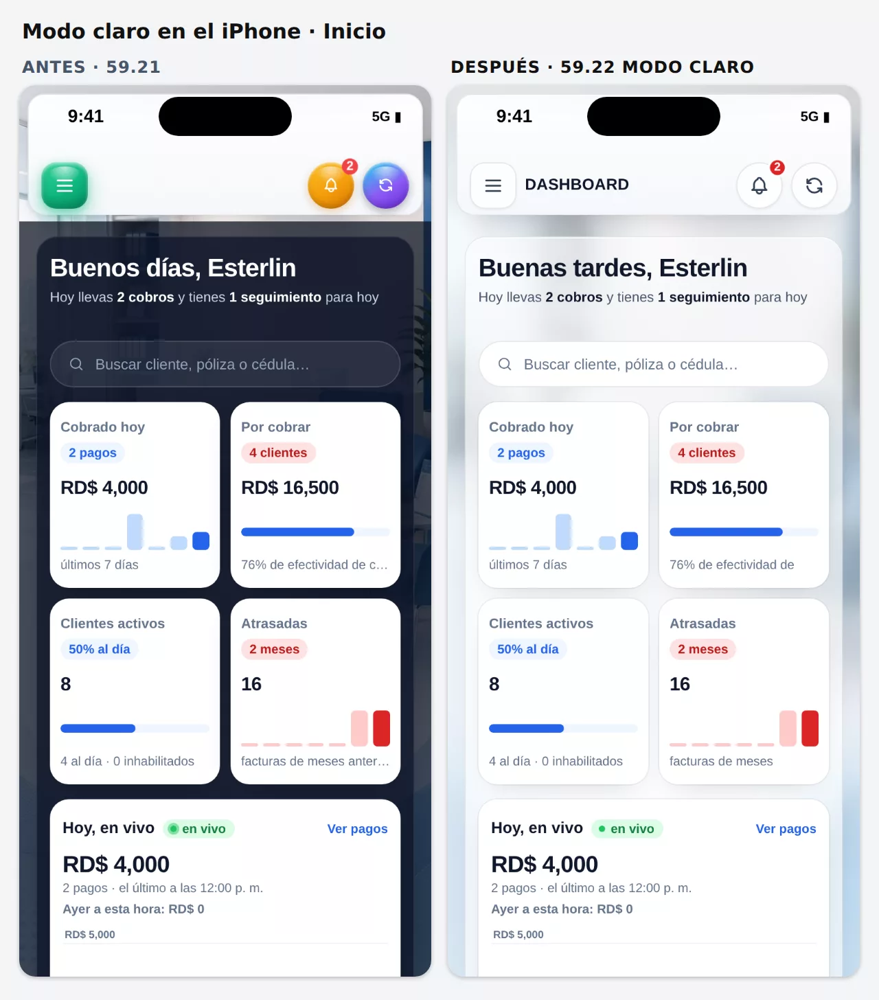
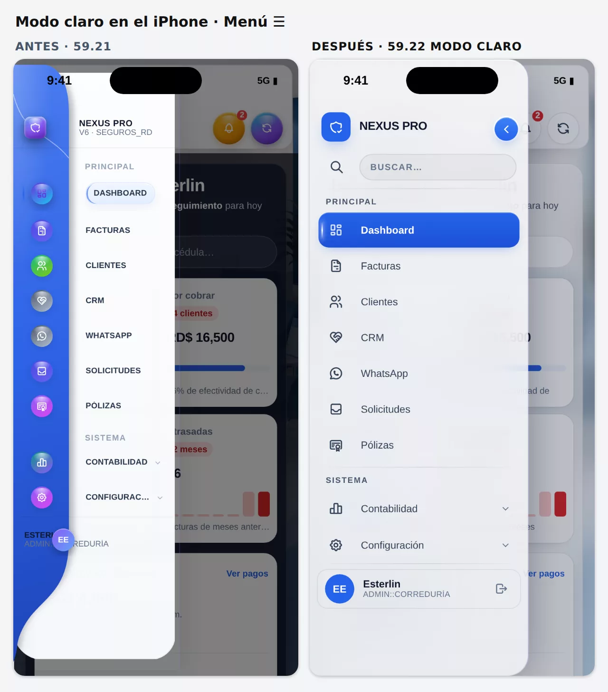
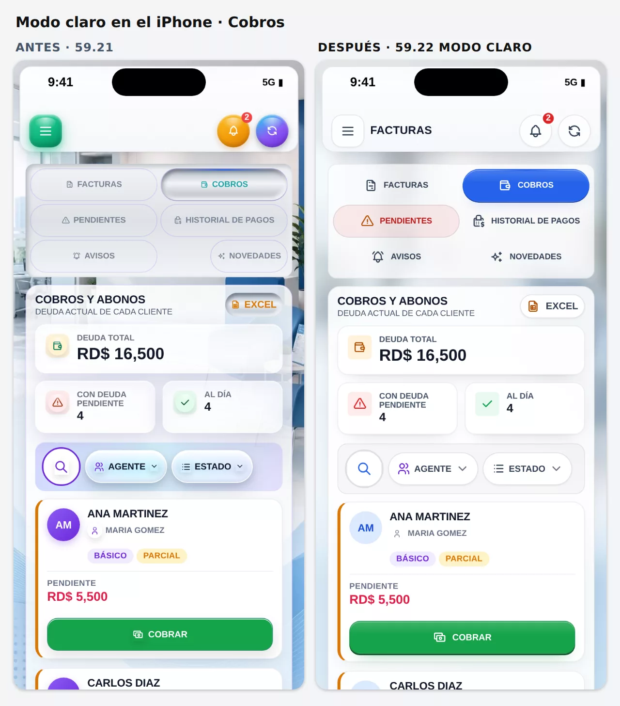
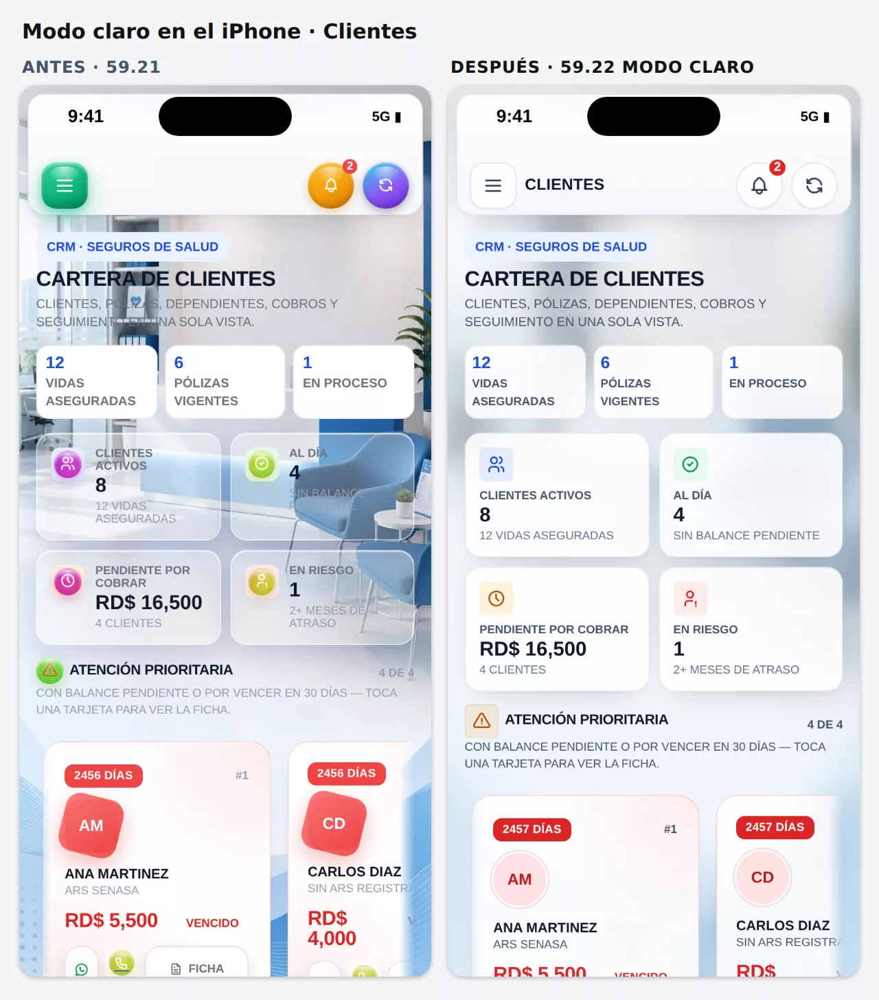
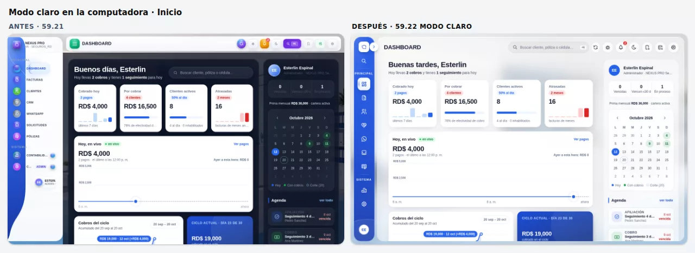
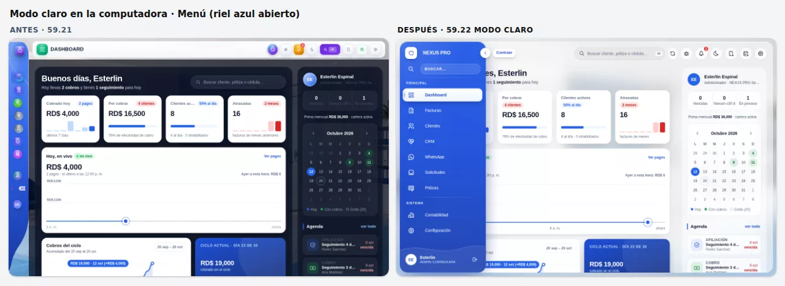
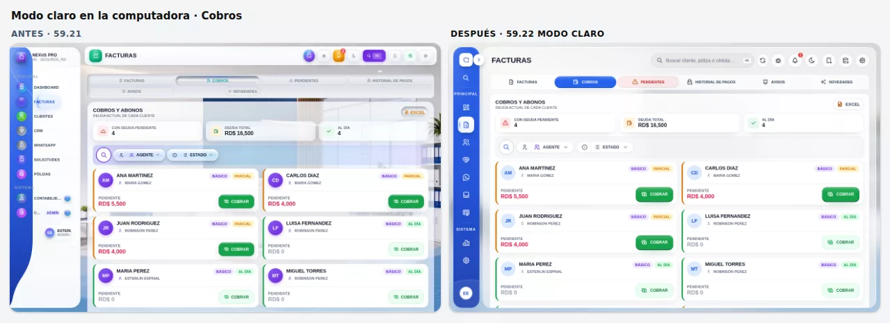
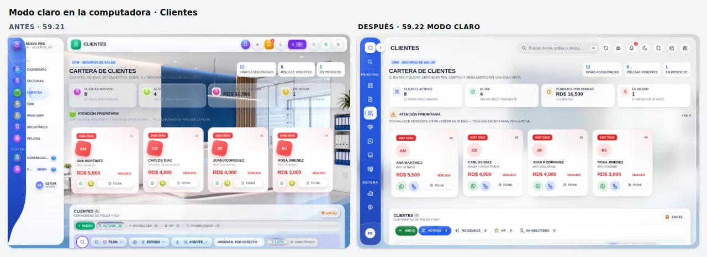

# 2026-10-12 10:00 — Claude · 59.22: modo claro (gemelo del grafito) y riel azul NEXUS en la PC — sin publicar

## Pedido del dueño
> «Ahora vamos con el modo claro.»

Llega después de la 59.21 (modo oscuro grafito y botones «nivel pro»). El modo claro es el **Clásico**: el que pone el botón sol/luna de la barra de arriba (`toggleDarkMode()` alterna Glass oscuro ↔ Clásico).

## Fuente de verdad (auditada antes de tocar)
Capturas del Clásico en 390 px (iPhone, área segura 59/34) y 1280 px, en 15 pantallas. Lo que se encontró:
- **Fondo:** la foto de oficina (`#nxBgPhoto`, `bg-office-*.jpg`) se veía **nítida**, con textos encima que costaba leer (por ejemplo «SIN BALANCE PENDIENTE» sobre una silla).
- **Barra de arriba:** botones «caramelo» en 3D: ☰ verde, campana naranja y actualizar morado (`parches-seguros-base.js`, «botones cristalinos 3D»). En el celular no salía el título de la pantalla.
- **Menú de la computadora:** el carril azul curvo de 210 px (`parches-sidebar-curva.css`, 19-sep) con los nombres cortados: «CONTABILID…», «C… ADMIN» y el usuario «ESTERL ADMIN::».
- **Cajón ☰ del celular:** el bloque del usuario se montaba encima de su rol.
- **Capa global «semi-glass»** (`nx-semi-glass-global-css`): borde **morado** en todos los botones, campos, tarjetas y ventanas; tarjetas al 86–68 % que dejaban ver la foto nítida.
- **Pestañas y botones de las vistas:** metálicos (gris con acento verde azulado, 28-ago); la pestaña activa parecía un botón hundido de metal.
- **Íconos:** bolitas 3D de colores (`colorize` de `parches-seguros-base.js`), los mismos que el dueño pidió quitar en el oscuro el 30-sep.
- **Inicio:** salía con el **panel azul oscuro** (`#nxIG`, sombra `rgba(9,14,28,.72)`) también en modo claro.
- **Acento:** morado (`--c1:#6d28d9`), distinto del azul NEXUS del oscuro.
- **WhatsApp:** donde no hay mensajes salía el texto **«ea4a»** (faltaba una barra en `content:"\ea4a"` dentro del JS; pasaba en todos los temas).

Decisiones anteriores del dueño que se respetaron:
- la **foto de oficina** del Clásico (septiembre: «el fondo blanco persistía», quería la foto) → se queda, pero suave;
- la **barra blanca sólida** del 02-oct («sin neblina encima del contenido») → se queda;
- las **cifras «cristalizadas»** (30-ago) → siguen en vidrio blanco al 80 %;
- la **ventana de pago neumórfica** (piloto del dueño) → no se toca.

El **carril azul curvo** (referencia del 19-sep) no se tira: vuelve **mejorado** como **riel azul NEXUS** (punto 3b), elegido por el dueño el 12-oct.

## Qué se hizo (rama `claude/modo-claro`, desde `main` 2906ac0)
### 1. Una marca para el modo claro, antes del primer cuadro
- `html.tema-claro` la pone el mismo `<script>` del `<head>` que pone el grafito, y `aplicarTema()` al cambiar de tema. Sin parpadeo (FOUC).
- **Interruptor:** `NX_TEMA_CLARO=false` en el `<head>` (todos) o `localStorage.nx_claro_off='1'` (un equipo) → el Clásico vuelve a ser el de la 59.21.

### 2. La misma estructura que el grafito, sin cambiar el grafito
- Las reglas de **estructura** del grafito pasan de `html.tema-glass-oscuro` a `html:is(.tema-glass-oscuro,.tema-claro)`: **misma especificidad**, mismo orden.
  - 367 selectores en `index.html`: menú de cristal (`nxMenuCristal`), botones «nivel pro» (`nxBotonesPro`), íconos planos (`nxIphone5893`, §1–6), riel de la computadora y cajón del celular, cabecera dentro del panel principal, título en el celular, capas de la escena y ajustes de maquetación.
  - 38 en `parches-nav-botones.js` (✕ y ‹ redondas de las ventanas).
- **JS:** `glass()` de `parches-menu-cristal.js` y `parches-nav-botones.js`, `riel()` de `nxTgoRail` y `oscuro()` de `parches-seguros-base.js` (íconos planos) aceptan también el modo claro.
- **Comprobado:** el grafito, el Premium y el Liquid Glass quedan iguales (ver Pruebas).

### 3. La paleta clara (`<style id="nxTemaClaro">`, al final del `<head>`, 53 KB con el riel azul y su apertura)
- **Escena:** la misma oficina, desenfocada dentro del archivo (`assets/fondo-oficina-claro.webp`, 7 KB, y `-movil`, 4 KB), con velo blanco. Sin desenfoque en vivo (batería). Entra con fundido (`html.tgc-foto`).
- **Cristal blanco** en el cajón ☰ del celular y en el panel principal; líneas `rgba(15,23,42,.08)`; texto `#0F172A` / `#334155` / `#64748B`. (El riel de la computadora va en azul: punto 3b.)
- **Un solo acento: azul NEXUS `#2563EB`** (antes morado).
- **Barra de arriba:** botones de cristal claro con el ícono oscuro; título en el celular. Sin conexión, el ☰ se tiñe de rojo.
- **Ventanas:** hoja blanca nítida sobre un velo suave; ✕ redonda gris clara.
- **Tarjetas, tablas y campos:** blancos, filo fino, sin el borde morado; campos con anillo azul al enfocar.
- **Pestañas:** carril blanco y la activa en píldora azul. **Botones de las vistas:** blancos con filo fino; los principales azul, verde y rojo sólidos con el acabado «nivel pro».
- **Inicio claro:** sin el panel azul oscuro; paneles de cristal blanco y tarjetas blancas. «Ciclo actual» sigue azul.
- **Pantalla de carga clara** y `theme-color` `#EEF1F5`: ya no hay un destello oscuro al abrir en modo claro.
- **«Reducir transparencia»** (iPhone → Accesibilidad): el cristal pasa a blanco sólido (el riel azul, a azul sólido).

### 3b. Riel azul NEXUS en la computadora (pedido del dueño a mitad de la entrega)
> «Que podemos hacer con la barra azul lateral como la anterior podemos mejorarla y aplicarla a la actual ?»

Se le mostró la propuesta en capturas (antes 59.21 | ahora | riel azul) y una alternativa en palabras (la franja azul con los nombres sobre blanco, como la de antes). Eligió en el chat:
- **«Riel azul así»** para el modo claro, y **«Oscuro sigue igual»**: el grafito no cambia.
- Después: **«Solamente en la Pc — La barra fija»**. Al preguntarle qué quería decir con «fija», eligió **«La barra de la PC, como ahora»**: se abre y se cierra igual que hoy.

Qué es:
- **El mismo riel** de cristal de la computadora (76 px que se abre al tocar la flecha o al pasar el mouse), en **azul NEXUS** translúcido (degradado `#245CE8` → `#1D4ED8` → `#1E40AF`).
- **Íconos y nombres en blanco.** El elegido va en **píldora blanca** con el ícono y el nombre en azul `#1D4ED8`.
- **La rayita de brillo del elegido** (pedido del dueño del 02-oct) se vuelve a ver: azul sobre la píldora blanca, como en el menú de antes. En el modo claro de esta misma rama había quedado escondida en la computadora.
- **La curva del menú de antes:** una ola blanca suave al pie que hace de divisoria encima de la tarjeta del usuario.
- **Logo, avatar y chevron en blanco** con el azul; el buscador es una píldora translúcida con letras blancas.
- **Contabilidad y Configuración** se despliegan en el mismo azul.
- **Lo que se corrigió del de antes (59.21):** nombres cortados («CONTABILID…», «C… ADMIN»), la tarjeta del usuario montada, las bolitas de colores en 3D y un carril fijo de 210 px.
- **«Reducir transparencia»:** el riel pasa a azul sólido `#1D4ED8`.
- **Celular:** el cajón ☰ **sigue en cristal blanco** con el elegido en píldora azul. Su rayita de brillo pasa a **blanco**: la regla general de los temas claros la pintaba azul y sobre la píldora azul no se veía.
- **Código:** una sección nueva, `2b`, dentro de `style#nxTemaClaro`. Casi todo va dentro de `@media (min-width:769px)`: los tokens `--nx-mc-*` del azul, más los colores y la curva. Aparte, la rayita blanca del cajón del celular. Las reglas llevan `:not(#_n)×3` (4 ids) para ganar a las compartidas del grafito, que llegan a 3. Para quitarlo basta borrar esa sección.

### 3c. Apertura del riel azul con animación (pedido del dueño)
> «Podemos hacer una mezcla con diseño y animación cuando la barra se vaya abrir»

Se diseñó con las skills `emil-design-eng` y `apple-design`. La barra se abre decenas de veces al día, así que la animación es **corta y no estorba**:
- **Cascada:** el nombre de cada fila entra después del de arriba (20 ms entre una y otra). Se desliza 8 px y se enfoca: arranca con un desenfoque de 2 px. Siguen el mismo orden el nombre «NEXUS PRO», el buscador y la tarjeta del usuario.
- **Reflejo:** un brillo de cristal cruza el azul una sola vez al abrir (0,75 s). Usa la capa `::after` del menú, que en la computadora estaba libre con estos temas.
- **Luz:** un resplandor suave arriba a la izquierda le da volumen al azul. Es fijo, no se mueve.
- **Cierre:** más rápido que la apertura y sin rebote (0,3 s). La apertura conserva el resorte del grafito (0,42 s). Se logra cambiando `--nx-mc-dur` y `--nx-mc-ease` según el estado.
- **«Reducir movimiento»:** sin cascada, sin reflejo ni desplazamiento; solo el fundido.
- **Arreglo encontrado al grabarla:** la luz de vidrio que sigue al mouse (59.05, una capa por encima de todo) se pintaba encima del menú abierto cuando el mouse quedaba en una tarjeta tapada en parte por él (una rayita blanca sobre el azul). Ahora se apaga mientras el menú está abierto, solo en el modo claro de la computadora; las filas del menú tienen su propio resaltado.
  - **Pasa igual en el modo oscuro** (ya estaba en 59.21). No se tocó porque el dueño pidió dejar el oscuro igual. Se arregla con la misma regla si lo pide.
- **Video para el dueño:** 9 s, abre, cierra, vuelve a abrir y elige Clientes.

### 4. Otros
- **Configuración → Apariencia:** la opción se llama «Claro» («El mismo diseño del Glass oscuro, en blanco…»). Mismo id (`clasico`): la preferencia guardada no cambia.
- **Botón sol/luna:** su nombre dice a qué modo lleva («Modo claro» / «Modo oscuro»).
- **Arreglos:**
  - «ea4a» de WhatsApp (todos los temas): `content:"\\ea4a"` en `parches-whatsapp-visual-v4.js`;
  - «Reintentar» de un mensaje que no salió, legible en claro (era rosa claro sobre rosa);
  - la **píldora azul del menú** ahora sigue a la pantalla abierta: WhatsApp, CRM, Solicitudes, Préstamos, Punto de venta y Rifas marcan su botón por su cuenta y la píldora se quedaba en la pantalla anterior (en el oscuro también). Un `MutationObserver` en el script del indicador la mueve cuando cambia `.on`.
- **Versión:** `APP_VERSION` 59.22, loader `b=6027`, `version.json`.

### 5. Primer cuadro de Premium y Liquid Glass (encontrado en las pruebas)
- **Qué pasaba:** esos dos temas viven en el `<body>` (`body.tema-premium` / `body.tema-glass`), y la clase la ponía `nxTemaBodyOn`, el primer `<script>` del `<body>`. El navegador a veces pinta un cuadro justo después de crear el `<body>` y antes de correr ese script, así que el primer cuadro salía con el tema clásico (60–130 ms) y después cambiaba.
- **No era nuevo:** en la 59.21 publicada también pasaba en 3 de 4 cargas de Premium con la máquina ocupada. Con esta entrega el `<head>` creció de 581 a 642 KB y pasaba siempre (6 de 6 cargas de Premium; Liquid Glass, 3 de 4). `qa-tema-glass` lo marcó dos veces seguidas en la rama.
- **Arreglo:** el script del `<head>` pone la clase en cuanto el parser crea el `<body>`, con un `MutationObserver`, cuyo aviso corre antes del siguiente pintado. `nxTemaBodyOn` se queda y la repite por si acaso.
- **Comprobado:** Premium 6 de 6 y Liquid Glass 4 de 4 cargas salen con su tema desde el primer cuadro. El modo claro y el grafito, que viven en `<html>`, siguen igual.

## Referencias que mandó el dueño durante la entrega
Quedaron anotadas en `HERRAMIENTAS.md` → «Referencias de diseño», con su regla del 11-oct: son para cuando queramos algo.
- **Reel de notas de voz** de @designmotionhq (`DeY-H8hDDRk`):
  - mantener para grabar y deslizar para cancelar;
  - bloquear la grabación;
  - onda en vivo con aviso de «micrófono silenciado»;
  - barra para saltar dentro del audio y velocidad 1,5x.
  - **Uso:** mejorar las notas de voz del WhatsApp de NEXUS (`parches-whatsapp-voz-mensajes.js`). Se miró con la skill `ver-video-redes`. El «UX Engine» que anuncia no se instaló.
- **svgl** (`https://svgl.app`, captura de un reel): 670 logos de marcas en SVG, con una API gratis sin clave.
  - Tiene WhatsApp, Gmail, Excel, PayPal, Mercado Pago y redes sociales.
  - No tiene Samsung, Xiaomi, Motorola, Huawei, Visa ni Mastercard: esas están en **Simple Icons** (CC0, comprobado).
  - Los logos son marcas de sus dueños.

## No se tocó
- Supabase (tablas, RPC, triggers, migraciones, permisos, datos), Edge Functions, Zernio, Realtime, automatizaciones, cobros ni la carga/envío de WhatsApp.
- La pantalla de entrada sigue oscura en los dos modos (solo el escudo queda igual que en el grafito).

## Pruebas
Todas corrieron con la REST simulada `qa-crm-mock-server.js`, y cada una con un simulador nuevo. La «base» es `main` 2906ac0 (la 59.21 publicada).

### Prueba nueva: `scripts/qa-modo-claro.mjs` — **99/99**
Revisa:
- **Carga:** primer cuadro claro (`html.tema-claro`, `#EEF1F5`, sin ningún cuadro del grafito); pantalla de carga clara; `theme-color` `#EEF1F5`; la oficina desenfocada sin la foto nítida.
- **Acento e íconos:** acento `#2563EB` e íconos planos.
- **Pantallas:** Inicio, Clientes, Cobros, Pólizas y WhatsApp, en 390 y 1280, sin superficies grandes oscuras y sin textos bajo 3:1.
- **Barra de arriba** de cristal claro, con el título en el celular.
- **Menú:**
  - cajón ☰ blanco con la píldora azul y la rayita blanca;
  - riel azul con la píldora blanca y la rayita;
  - la píldora sigue a WhatsApp y al CRM;
  - nombres legibles sobre el azul.
- **Apertura:** resorte al abrir, cierre rápido, reflejo, cascada y la luz de vidrio apagada con el menú abierto.
- **«Nuevo cliente»:** hoja blanca, filo gris y anillo azul al enfocar.
- **Apariencia «Claro»,** botón sol/luna y cambio en vivo de ida y vuelta.
- **«Reducir transparencia»:** riel azul sólido y panel blanco sólido.
- **Interruptor `nx_claro_off`:** el Clásico de antes, con acento morado, foto nítida y carril de 210 px.

### Legibilidad con píxeles reales en el modo claro (copia de `qa-legibilidad` con el tema Clásico)
Mide cada texto contra los píxeles de verdad que tiene detrás: 146 pantallas, en 390 y 1280, como admin y como agente.

| | 59.21 (base) | 59.22 (rama) |
|---|---:|---:|
| Textos con poco contraste (fuera del Buzón) | **1 145** de 9 417 | **267** de 7 790 |
| Inicio 390 / 1280 | 35 / 45 | 2 / 3 |
| Clientes 390 / 1280 | 98 / 112 | 15 / 15 |
| Cobros 390 / 1280 | 7 / 14 | 0 / 1 |
| Pólizas 390 / 1280 | 22 / 45 | 0 / 1 |
| Facturas 390 / 1280 | 8 / 15 | 0 / 1 |
| CRM 390 / 1280 | 24 / 33 | 5 / 7 |
| Buzón 390 / 1280 | 4 / 15 | 1 / 5 |

- En la rama hay menos textos medidos: el carril de 210 px de antes mostraba sus nombres en todas las pantallas.
- **Lo que queda (267)** es, sobre todo, Préstamos, Punto de venta, Notificaciones y los colores de estado heredados: las fichas «AUTO OFF» y «100 % listo», «Vencido» y los montos en verde claro. Queda para otra entrega.

### Las demás pruebas, rama contra base
Primero corrió una tanda de 22 pruebas en las dos (rama y base, al mismo tiempo), antes del riel azul: 16 dieron exactamente igual.

Lo que vino después solo toca el modo claro en la computadora y el primer pintado de Premium y Liquid Glass. Por eso se repitieron sin otra carga en la máquina:
- las 6 distintas;
- `qa-modo-claro`, `qa-menu-cristal`, `qa-tipografia` e `qa-inicio-glass`;
- el volcado de los temas oscuros.

`qa-tema-glass`, `qa-modo-claro`, `qa-iconos`, `qa-whatsapp-lista`, las 3 del puerto fijo y el volcado corrieron con el código final.

| Prueba | 59.21 (base) | 59.22 (rama) | Nota |
|---|---|---|---|
| `qa-modo-claro` (nueva) | — | **99/99** | |
| `qa-tema-glass` | 550/550 | **550/550** | Con el arreglo del primer cuadro de Premium (punto 5). Sin él, la rama falló 2 veces seguidas ahí. |
| `qa-iphone` | 565/565 | **569/569** | +4 del modo claro. |
| `qa-legibilidad` (oscuro) | 150/150 | **150/150** | |
| `qa-iconos` | 102/105 | **205/209** | Ahora recorre también el modo claro. Las 4 fallas ya estaban en la base: el verde de WhatsApp en Facturas (390 y 1280) y la ✕ de 16 px de la ventana de pago (en el oscuro y en el claro). Los círculos de resumen de la ventana de pago neumórfica se anotan como excepción en el claro (piloto del dueño, no se toca). |
| `qa-whatsapp-lista` | 158/158 y 151/158 | **158/158** | La comprobación de «Cobrar» en un chat sin cliente depende de los tiempos en las dos versiones: la prueba cambia el chat en memoria y una recarga lo puede pisar. |
| `qa-vidrio-smart` | 17/18 | **18/18** | |
| `qa-menu-cristal` | 67/67 | **67/67** | |
| `qa-tipografia` · `qa-inicio-glass` | 152/152 · 129/129 | **152/152 · 129/129** | |
| `qa-cobros` · `qa-cobro-vivo` · `qa-whatsapp-chat` · `qa-whatsapp-sinlag` | 161 · 73 · 95 · 34 | **iguales** | |
| `qa-brillo-fijo` · `qa-custodia` · `qa-isla-avisos` · `qa-registrar-pago` | 10 · 68 · 38 · 54 | **iguales** | |
| `qa-pos-fase1` · `qa-pos-fase2` · `qa-recibo-compartir` | 36 · 11 · 28 | **iguales** | |
| `qa-whatsapp-legibilidad` · `qa-nav-botones` · `qa-busqueda-premium` | 116/118 · 262/264 · 229/235 | **iguales** | Las mismas fallas que ya estaban: textos sobre fotos en el chat, 2 de los botones de navegación y la lupa que no se deja tocar en 6 pantallas de la computadora. |
| `qa-foco-lista` | 12/24 | **12/24** | Prueba vieja: espera la rueda de las listas que el dueño quitó en la 59.19. |
| `qa-crm` | se detiene | **se detiene igual** | Prueba vieja: escribe en la búsqueda del CRM, que desde la «búsqueda premium» está detrás de la lupa. |

### El modo oscuro no cambió
Volcado de estilos de lo visible (17 pantallas, en 390 y 1280) del grafito, el Premium y el Liquid Glass, rama contra base. Solo cambian 3 cosas, todas buscadas:
- en WhatsApp sale el ícono en vez del texto «ea4a»;
- la píldora del menú se queda en WhatsApp o en Configuración (antes se quedaba en la pantalla anterior);
- en Apariencia, la opción «Claro» con su muestra y su descripción nuevas.

### Primer cuadro con cada tema (carga con la máquina ocupada)
| Tema | 59.21 (base) | Rama sin el arreglo | Rama final |
|---|---|---|---|
| Premium | 3 de 4 cargas con un cuadro clásico antes | 6 de 6 con un cuadro clásico | **6 de 6 bien** |
| Liquid Glass | — | 3 de 4 con un cuadro clásico | **4 de 4 bien** |
| Modo claro · grafito | — | — | **3 de 3 bien** cada uno |

### Herramientas de prueba que se corrigieron por el camino
- **`qa-iconos`:** el script de inicio de la página usaba `claroOff` sin recibirlo. Lanzaba un error antes de crear la sesión, la página se quedaba en la entrada y la prueba esperaba 25 s.
- **`qa-modo-claro`:**
  - mide el contraste del menú contra la capa base del azul, no contra la luz de la esquina;
  - si otra pantalla le quita el foco al campo de «Nuevo cliente», lo vuelve a enfocar una vez.
- **Ojo para la próxima:** cambiar `index.html` mientras corre una tanda deja resultados mezclados. Aquí pasó dos veces y esas pruebas se repitieron.

## Antes / después
Capturas en iPhone 390 (área segura 59/34) y en computadora 1280, con los mismos datos de prueba.

El dueño también recibió el video de la apertura del riel azul (9 s).

## Riesgos y pendientes
- **Verlo en el iPhone real** en modo claro: fondo, cajón ☰, Inicio, WhatsApp y la ventana de pago.
- **Verlo en la computadora:** el riel azul, su apertura y Contabilidad/Configuración.
- **Lo que queda de contraste en el claro (267 textos):** Préstamos, Punto de venta, Notificaciones, Mayor, bancos y los colores de estado heredados («AUTO OFF», «100 % listo», «Vencido», montos en verde claro). Va en otra entrega si el dueño quiere.
- **Pasa igual en el oscuro (ya estaba en 59.21):** la luz de vidrio que sigue al mouse se pinta encima del menú abierto. En el claro ya se apaga con el menú abierto; en el oscuro se arregla con la misma regla si el dueño lo pide.
- **Ya estaba antes (los dos temas):**
  - en la app abierta desde el ícono, el título de «Registrar pago» queda debajo de la hora del iPhone;
  - el ícono de «Reporte plan» no aparece en el panel de Contabilidad;
  - la ✕ de la ventana de pago mide 16 px.
- **Pruebas viejas:** `qa-crm` (la búsqueda detrás de la lupa) y `qa-foco-lista` (la rueda que se quitó) hay que ponerlas al día.
- **Para volver atrás:**
  - todo el modo claro: `NX_TEMA_CLARO=false` en el `<head>`, o `localStorage.nx_claro_off='1'` en un equipo;
  - solo el riel azul: borrar la sección `2b` de `style#nxTemaClaro`;
  - todo: `git revert` de los commits de la 59.22.

## Publicación
- **No publicado.** Rama `claude/modo-claro` (desde `main` 2906ac0), subida a GitHub. Espera el «publícalo» del dueño.
- **Al publicar:**
  - fast-forward de `main` desde la rama;
  - `AGENTS.md` (estado vivo → 59.22);
  - bitácora de publicación.
- El deploy lo hace la integración Git de Cloudflare Workers. Después, revisar que `https://nexusprord.com/version.json` diga 59.22.

## Skills usadas
- **`emil-design-eng`:** la apertura del riel: cuánto animar algo que se abre decenas de veces al día, cascada corta, cierre más rápido que la apertura, desenfoque para suavizar la entrada y «reducir movimiento».
- **`ver-video-redes`:** bajar y mirar el reel de notas de voz (yt-dlp y mosaicos de cuadros).
- **`apple-design`:** materiales translúcidos sobre una escena ya desenfocada, superficies grandes más «gruesas», un solo acento, «reducir transparencia» y «reducir movimiento».
- **`webapp-testing`:** Playwright para las capturas, el volcado de estilos, los cuadros en cámara lenta, el video y las pruebas.
