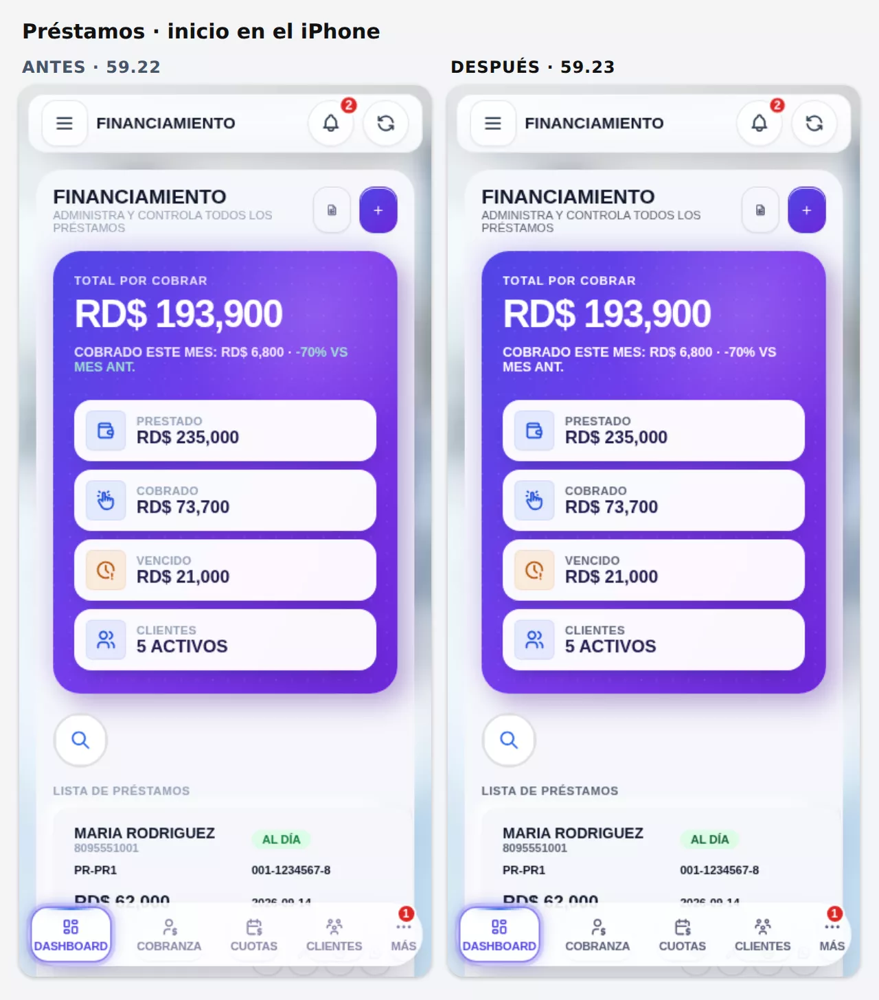
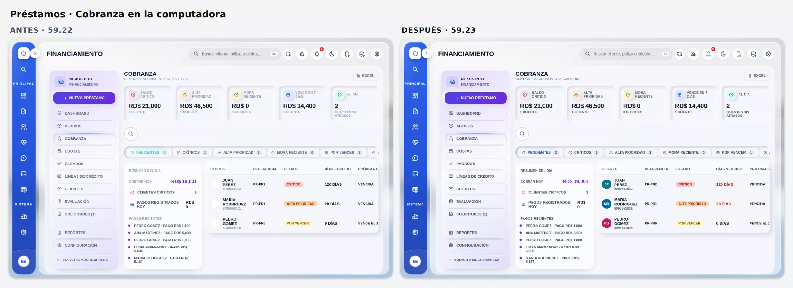
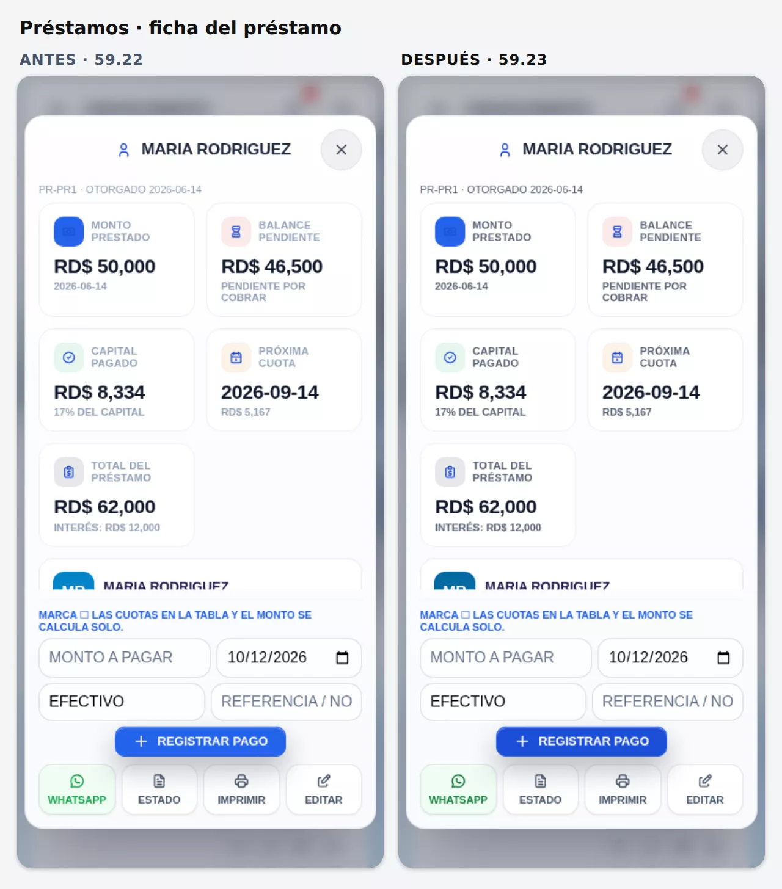
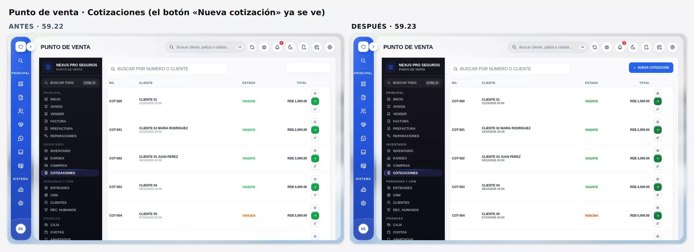
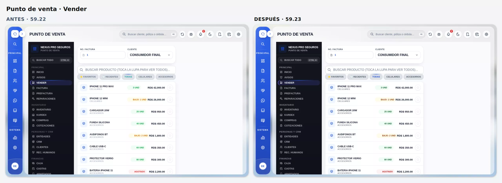
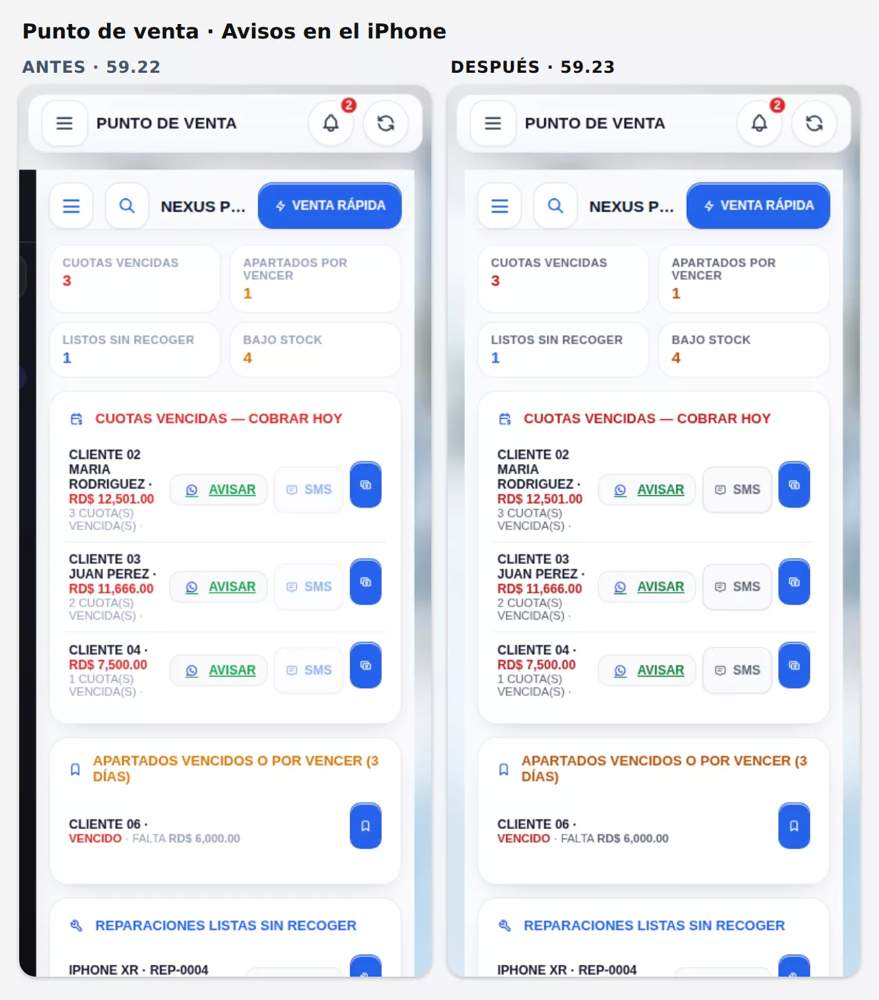

# 2026-10-12 12:00 — Claude · 59.23: contraste del modo claro en Préstamos y Punto de venta — sin publicar

## Pedido del dueño
> «Ahora mejora el contraste de Préstamos y Punto de venta»

Llega justo después de publicar la 59.22 (modo claro nuevo, bitácoras `2026-10-12-1000-claude.md` y `2026-10-12-1029-claude.md`). Se trabaja **solo el modo claro** (`html.tema-claro`). El oscuro, el Premium, el Liquid Glass y el Clásico de antes (`nx_claro_off`) no cambian.

## Fuente de verdad (medida antes de tocar)
Prueba nueva **`scripts/qa-claro-modulos.mjs`**.
- Abre **cada pantalla interna** de los dos módulos con datos simulados, para que no salgan vacías: 6 préstamos, 25 clientes, 14 productos, ventas, cuotas, apartados y reparaciones. La base real no se toca.
- Mide **cada texto contra su fondo real**: una captura con el texto transparente (cuentan degradados, cristal y fotos). Falla si la razón WCAG es menor de 4.5:1, o de 3:1 en letra grande.
- **Préstamos, 15 pantallas:** Dashboard, Activos, Cobranza, Cuotas, Pagados, Líneas de crédito, Clientes, Evaluación, Solicitudes, Reportes, la ficha de un préstamo y la de una línea de crédito, Nuevo préstamo, Configuración y la hoja «Más» del celular.
- **Punto de venta, 25 pantallas:** las 24 pestañas del menú y el cajón del celular.
- Todo a 390 px (iPhone) y a 1280 px: **78 pantallas, 5,128 textos**.
- Resultado en `main` (59.22): **1,402 textos con poco contraste**; solo 3 de las 78 pantallas pasaban.

Lo que se encontró:
- **Rótulos grises `#94a3b8` (≈ 2.4:1) en casi todo.** Por ejemplo «INTERÉS COBRADO», «LISTA DE PRÉSTAMOS», los teléfonos, «Ventas», «Sin ventas hoy todavía», las categorías de los productos, notas y fechas.
  - En el POS vienen de dos fichas compartidas de `parches-pos-stitch-visual.js`: `--nx-mute` y `--nx-steel`. Alimentan `--pf-txt3` y `--pf-txt2` (143 y 51 usos en `parches-pos.js`).
  - En Préstamos vienen de clases con el color fijo (`nxFPEnsureCSS`, en `parches-pos.js`) y de `style="color:#94a3b8"` en las plantillas.
- **Colores de estado claros:** verde `#16a34a` (3.3:1), ámbar `#d97706` (3.2:1), naranja `#ea580c` (3.6:1), cian `#0891b2` (3.7:1), rosado `#db2777` (4.2:1).
- **Acento verde azulado `#1ca2a4`** en pestañas y píldoras activas: ≈ 2.4:1 sobre el gris de la píldora. Es un resto del estilo metálico; en Seguros, el modo claro ya lo había cambiado por el azul.
- **Héroe morado de Financiamiento:** rótulos blancos al 75–90 % y la tendencia en verde menta (3.2:1).
- **Menú lateral oscuro del POS:** PRINCIPAL, INVENTARIO… al 36 % (≈ 2.9:1).
- **Dos fallos que no eran solo de contraste:**
  1. **Botones invisibles en el POS**, blancos sobre blanco: «Nueva cotización», «Nueva entidad», «Nueva oportunidad», «Nuevo cliente», «Nuevo apartado», «Guardar ajustes», «Guardar mora», «Crear roles base», «Agregar vendedor», «Borrar datos de prueba»… Causa: los botones pequeños del POS llevan la clase `sm` («pequeño»), que en Seguros es la clase de **tarjeta**. La capa de superficies (`nx-semi-glass-global-css` y la §6 del modo claro) les ponía fondo de cristal blanco con `!important`.
  2. **Iniciales de los clientes en Cobranza** (avatar pequeño, también con `sm`): el mismo choque, iniciales blancas sobre blanco.
- **De paso:** en el celular, el **menú cerrado del POS se asomaba** como una franja oscura de 16 px a la izquierda. El `#v-pos` lleva `transform` y `filter` de la entrada, así que el cajón «fijo» se mide desde el panel y no desde la pantalla.

## Qué se hizo (rama `claude/claro-contraste`, desde `main` 4b276d3)
Solo CSS: una sección nueva **§12** al final de `style#nxTemaClaro` (`index.html`, ≈ 17 KB).
- 70 reglas con 75 selectores, todos empiezan con `html.tema-claro`; Chromium las acepta todas.
- No se tocaron `parches-pos.js`, `parches-financiamiento.js` ni ninguna otra capa, así que el loader sigue en `b=6027`.
- Se borra entera si hiciera falta volver atrás.

### 1. Fichas de color (lo que más arregla con menos reglas)
- **POS:** `--nx-mute` `#94a3b8` → `#5B6577` y `--nx-steel` `#64748b` → `#475569`, en `#v-pos`, `#v-multiempresa`, `.nxPf`, `.modal.nxPrForm` y `body.org-tienda`. Arreglan de una vez los rótulos de KPI, avisos, categorías, fechas y el carrito vacío.
- **POS:** `--pf-green` → `#15803D`, `--pf-red` → `#B91C1C`, `--pf-orange` → `#B45309` y `--pf-pill-accent` (`#1ca2a4`) → `#1D4ED8`.
- **Préstamos:** `--nf-ink2` `#666d8c` → `#4E5470`: menú lateral de la computadora, «Volver a Multiempresa», pestañas y botones de la barra.

### 2. Clases con el color fijo
- **Rótulos → `#5B6577`** (≥ 5.2:1 en los fondos claros):
  - Préstamos: `.nxFP-dlbl`, `.nxFP-dsub`, `.nxFP-kpiLbl`, `.nxFP-kpiSub`, `.nxFP-topSub`, `.nxFP-listHead`, `.nxFP-gLbl`, `.nxFP-tSub`, `.nxFP-pgInfo`, `.nxFP-legPct`, notas de Reportes, la hoja «Más», `.nxPrTlTxt span` (línea de tiempo de la ficha), Evaluación (`.ev-*`) e historial crediticio (`.hc-*`).
  - POS: `.nxAppSecT`, `.nxTVEmpty`, `.plab`, `.dtit`, `.npfx`, `.keys` (atajos F2, F4…), `.nxRepNum span`.
- **Textos de apoyo y encabezados de tabla → `#475569`:** `.nxFP-cardMeta`, `.nxFP-empty p`, `.nxFP-cobSideTit`, `.nxFP-tbl thead th`, `.ev-paso`, `.ev-rsrow`; en el POS `.nxTKpiL`, `.nxTKpiS`, `.nxTPanelH small`.
- **Pestañas, filtros y píldoras** (`.nxFP-tab`, `.ev-tab`, `.hc-tab`, `.nxFP-perBtn`, `.chip`, `.vchip`, `.seg button`, `.nxInvPill`, `.nxFacSubTab`, `.entTab`, `.nxClaveTab`):
  - la inactiva en `#475569`;
  - la activa en **azul `#1D4ED8`** (antes verde azulado, ≈ 2.4:1);
  - el número de la píldora, sin el 70 % de opacidad.
- **Menú de abajo de Préstamos en el celular** (`.nxFP-dockBtn`): `#8b85a8` → `#565D78`.
- **Estados:**
  - «Activo» y «Al día» en `#166534`; «Pagado» en `#1D4ED8`;
  - «Vencido» (ámbar) en `#92400E` y «Por vencer» en `#854D0E`;
  - «En mora» y lo atrasado en rojo `#B91C1C`;
  - «Cancelado» en `#475569`;
  - existencias del POS («3 und», «Bajo», «Agotado») igual;
  - columnas de Reparaciones (variable `--rc`): Recibido, Diagnóstico y Listo, un tono más hondo.
- **Héroe morado de Financiamiento y el azul de Cuotas del POS:** rótulos al 100 % (antes 75–90 %). La tendencia «−70 % vs mes ant.» va en blanco (antes verde menta, 3.2:1).
- **Menú lateral oscuro del POS:** PRINCIPAL, INVENTARIO… al 58 % (antes 36 %: de ≈ 2.9:1 a ≈ 6:1). Nombre del negocio y rol al 66 %.
- **Botón principal azul de los dos módulos** (`.btn.bc1`: Abrir caja, Ajustar inventario, Registrar pago…): pasa a `#1D4ED8`. El brillo de arriba del acabado «nivel pro» lo dejaba en 4.46:1. En Seguros no cambia.

### 3. Colores escritos en el HTML (`style="color:…"`)
- Solo dentro de los dos módulos: `#v-prestamos`, `#v-pos`, `.nxPf`, `.nxPrForm`, las ventanas `#nxPr*`, `#evAmort` y `#nxFPDockHost`.
- Cambios: `#94a3b8` → `#5B6577`, `#64748b` → `#475569`, verdes → `#15803D`/`#047857`, ámbar → `#B45309`, naranja → `#C2410C`, rojos → `#B91C1C`, cian → `#0E7490`, verde azulado → `#0F766E`, rosado → `#BE185D`.
- Se cubren las dos formas del atributo:
  - la de la plantilla: `color:#94a3b8`;
  - la que deja el navegador cuando el **piso de 11 px** (`#nxTipoAppleMin`) reescribe un `style=` con letra chica: `color: rgb(148, 163, 184)`.
- Solo se buscan `color:` al principio o después de `;`, nunca `background-color:` ni `border-color:`.
- **Las celdas de tabla (`td`, `th`) quedan como estaban:** el modo claro ya las pone en tinta oscura.

### 4. Fallos que no eran solo de contraste
- **Botones invisibles del POS** (`.ab … sm`): vuelven a su color. Azul (`g2`), verde (`g1`) y rojo (`g4`) sólidos con letra blanca; el neutro (`g3`), blanco con un borde fino.
- **Iniciales de los clientes** (avatar pequeño de Cobranza): vuelven a su color. Además, los colores claros de la paleta de avatares (cian, verde, ámbar, rosado y azul cielo) pasan a su tono 700, para que la inicial blanca se lea (≥ 5:1).
- **«SMS» de un cliente que no aceptó avisos automáticos:** antes era azul al 50 % (2.1:1). Ahora va en gris entero (`#5B6577`): se lee y se nota que no está disponible. La lógica del botón no cambia.
- **Historial del POS:** la venta anulada ya no va al 50 % de opacidad. Queda la fila en gris claro, el texto `#5B6577`, el total tachado y su etiqueta ANULADA.
- **Cajón del POS en el celular** (≤ 860 px): cerrado, queda `visibility:hidden` después de salir, y ya no se asoma la franja oscura. Al abrir entra igual que antes.
- **Lo atrasado en las tablas de Préstamos** (días de mora y monto vencido con la clase `late`) vuelve a salir en rojo, como en el modo oscuro. El modo claro lo había dejado negro.

## Pruebas (rama contra `main`, con el simulador; la base real no se tocó)
### Prueba nueva: `scripts/qa-claro-modulos.mjs` — **86/86**
| | `main` (59.22) | rama (59.23) |
|---|---:|---:|
| Pantallas medidas (390 y 1280 px) | 78 | 78 |
| Textos medidos | 5,128 | 5,128 |
| **Textos con poco contraste** | **1,402** | **0** |
| — Préstamos | 611 | 0 |
| — Punto de venta | 791 | 0 |
| Pantallas sin ningún hallazgo | 3 | 78 |

- Uso: `PORT=8942 node scripts/qa-crm-mock-server.js &` y luego `QA_BASE=http://127.0.0.1:8942 QA_OUT=/ruta QA_TABLER=/ruta/tabler node scripts/qa-claro-modulos.mjs`.
- Filtros opcionales: `QA_ANCHOS`, `QA_MODULOS=prestamos,pos` y `QA_VISTAS=pr-dashboard,pos-inicio`. Con `QA_CAPTURAS=1` guarda la primera pantalla de cada vista.
- Deja `informe.md`, `hallazgos.json` y capturas con los textos afectados marcados en rojo.
- Mejoras del medidor frente a la copia de `qa-legibilidad`:
  - recorta cada línea de texto por los contenedores que la cortan (el texto con «…» ya no se mide debajo del botón vecino);
  - con una ventana o la hoja «Más» abierta, mide solo lo de adentro (lo de atrás queda velado a propósito).

### Lo que la rama dejó más claro (comprobado texto por texto, 4,770 en 390 px y 4,501 en 1280 px)
- Más oscuros: 1,652 y 1,526. Iguales: el resto.
- **Más claros, solo los buscados:**
  - la tendencia del héroe, de verde menta a blanco;
  - la venta anulada: antes era negro al 50 %;
  - lo atrasado de Préstamos, de negro a rojo;
  - la flecha ▼ sobre el azul de Cuotas, de rosado a rosado más claro.
- La primera versión de la rama aclaraba también encabezados y celdas de las tablas de Préstamos (fecha próxima, días, cédula), que el modo claro ya pintaba oscuros. Se corrigió antes de entregar: esas celdas quedan como estaban.

### Los temas que no deben cambiar — **0 diferencias**
Se comparó el estilo calculado (color, fondo, imagen, opacidad, visibilidad, sombra y borde) de **cada elemento** de 8 vistas de los dos módulos, entre `main` y la rama:
| Tema | Ancho | Elementos | Diferencias |
|---|---|---:|---:|
| Oscuro (grafito) | 390 · 1280 | 2,746 · 2,747 | 0 · 0 |
| Premium | 1280 | 2,746 | 0 |
| Liquid Glass | 1280 | 2,746 | 0 |
| Clásico de antes (`nx_claro_off`) | 390 · 1280 | 2,745 · 2,746 | 0 · 0 |

### Pruebas de siempre
| Prueba | `main` (59.22) | Rama | Nota |
|---|---|---|---|
| `qa-modo-claro` | 99/99 | **99/99** | En la primera corrida, con la máquina ocupada por otras dos pruebas, falló 1 vez el anillo azul de «Nuevo cliente» (Seguros), a mitad de su transición. Sola: 99/99. |
| `qa-tema-glass` (oscuro) | 550/550 | **550/550** | |
| `qa-iphone` | 569/569 | **569/569** | |
| `qa-iconos` | 205/209 | **205/209** | Las mismas 4 de antes: el verde de WhatsApp en Facturas (390 y 1280) y la ✕ de 16 px de la ventana de pago. |
| `qa-pos-fase1` · `qa-pos-fase2` · `qa-recibo-compartir` | 36/36 · 11/11 · 28/28 | **36/36 · 11/11 · 28/28** | |
| `qa-menu-cristal` · `qa-tipografia` · `qa-inicio-glass` | 67/67 · 152/152 · 129/129 | **67/67 · 152/152 · 129/129** | `qa-tipografia` e `qa-inicio-glass` usan el puerto fijo 8942. |
| `test-pos-caja-por-cajero` · `test-pos-venta-atomica` | fallan | fallan igual | Pruebas viejas: esperan `APP_VERSION` 58.38. No tienen que ver con esta entrega. |

`qa-tema-glass`, `qa-iphone`, `qa-menu-cristal`, `qa-pos-fase2` y `qa-recibo-compartir` corrieron con la penúltima versión de la §12. Después solo cambiaron reglas del modo claro (las celdas de tabla `td`/`th` y algunos rótulos de las tablas de Préstamos quedaron como estaban) y se subió la versión. La medición completa, las comparaciones y las pruebas del modo claro y del POS se repitieron con la versión final.

## Antes y después (modo claro)

## Versión
- `APP_VERSION` 59.23 y `version.json` 59.23 con sus notas.
- El loader de las capas sigue en `b=6027`: ninguna capa cambió, solo `index.html`.

## No se tocó
- Supabase: tablas, RPC, triggers, migraciones, permisos ni datos. Tampoco Edge Functions, Zernio, Realtime ni automatizaciones.
- La lógica de ventas, cobros, préstamos, SMS ni WhatsApp: solo colores, en el modo claro.
- `parches-pos.js`, `parches-financiamiento.js`, `parches-pos-stitch-visual.js` y las demás capas.

## Riesgos y pendientes
- **Los colores escritos en el HTML se corrigen con selectores de atributo** (`[style*=";color:#94a3b8"]`). Es seguro y reversible, pero es un parche.
  - Lo durable sería que las plantillas de los dos módulos usen las fichas (`var(--pf-txt3)`, `var(--nf-ink3)`), en vez de colores fijos. Eso toca `parches-pos.js` y `parches-financiamiento.js`; queda para otra entrega si el dueño quiere.
  - Un color nuevo escrito a mano en una plantilla no quedará cubierto; `qa-claro-modulos` lo detectaría.
- **El choque de la clase `sm` sigue en los otros temas:**
  - en el **oscuro**, los botones pequeños del POS salen como tarjetas oscuras con la letra blanca: se leen, pero no en azul, verde o rojo;
  - en el **Clásico de antes** (`nx_claro_off`), siguen blancos sobre blanco.
  - No se tocaron porque el dueño pidió que el oscuro siga igual; se puede arreglar igual que aquí si lo pide.
- **Detalles de maquetación del POS que se vieron y no se tocaron:**
  - en el iPhone, la tabla de Cotizaciones se sale un poco por la derecha (la columna de acciones);
  - el cajón del menú abre debajo de la barra de arriba y 16 px corrido, por el mismo `transform` del `#v-pos`. Funciona, pero se puede pulir.
- **En el modo claro, fuera de estos dos módulos,** siguen los pendientes de la 59.22: Notificaciones, Mayor, bancos y algunas etiquetas de estado.

## Publicación
**No publicado.** La rama `claude/claro-contraste` queda lista. Para publicar hace falta el «publícalo» del dueño.
- Después de publicar: revisar `https://nexusprord.com/version.json` (59.23) y ver en el iPhone y en la computadora, en modo claro, Préstamos (Dashboard, Cobranza, ficha) y Punto de venta (Inicio, Vender, Cotizaciones, Avisos, Caja). Comprobar también que el modo oscuro siga igual.
- **Volver atrás:** borrar la sección `12 · Préstamos y Punto de venta` de `style#nxTemaClaro`, o revertir el commit.

## Skills
Criterios de **`apple-design`** (legibilidad: el color de los textos con contraste suficiente y jerarquía por tono y peso, no por transparencia) y **`emil-design-eng`** (un solo acento y los detalles que se acumulan), ya cargadas en esta sesión. Las pruebas, con Playwright y el simulador del repo, como en las entregas anteriores.
